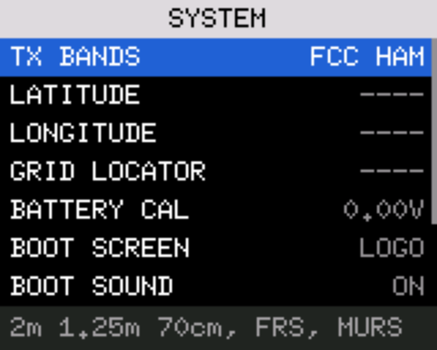
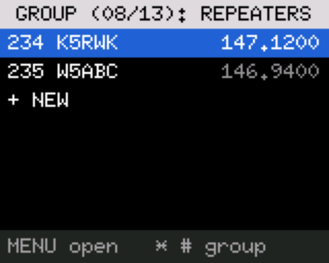
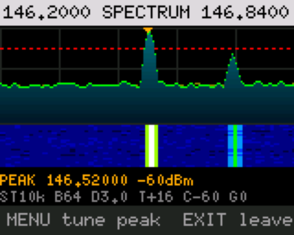
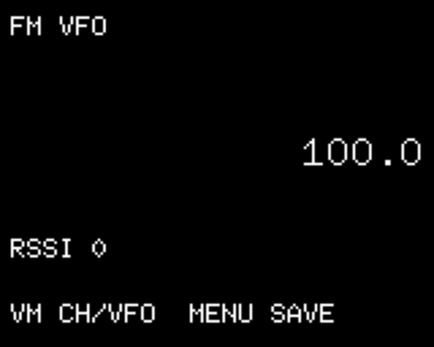
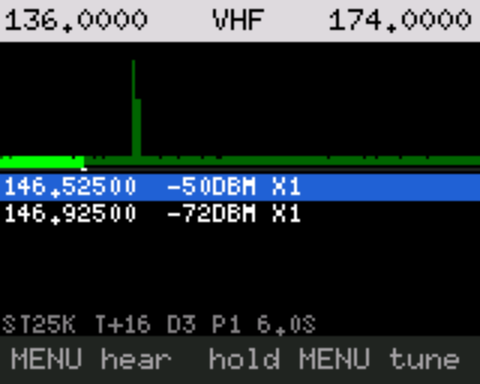
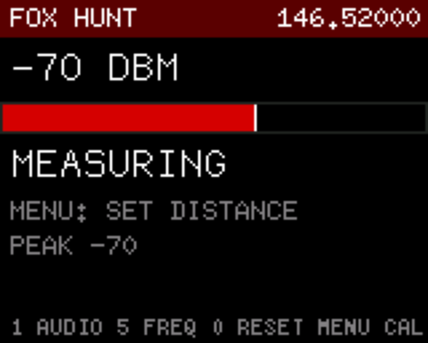

# Baofeng UV-5RM open firmware: apps, tools and a simulator

Open firmware for the Baofeng UV-5RM / UV-5RH handheld (board `5RHNRFB-YP07`), built on the community's
[UV-5RM-Radio-Mod](https://github.com/jakegarrett13-afk/UV-5RM-Radio-Mod), which is built on [bf-5rh-firmware-open](https://github.com/sophiel-meow/bf-5rh-firmware-open).
A small core runs the radio, the main screen and the channel groups, and nine overlay apps (settings, channel manager, spectrum, FM and others) are loaded from the radio's flash.
This repository audits the upstream code, rebuilds it reproducibly, and adds the apps, a host simulator, the tools that load a radio from a computer, and tests.

**Status (2026-11-12): one radio, seven flashes, nothing transmitted.** On that radio the core boots and receives, the calibration page is
unchanged after every flash, the nine apps and 116 channels load and read back, and PTT is refused by default (TX INHIBIT is on). Everything
built since the last flash (the new FM app, the split channel manager, the settings help and presets, the SPECTRUM and BAND SWEEP changes, the fault
screen, the installer) passes the simulator and the tool tests but **has not been seen on the radio**. The record is [AUDIT.md](AUDIT.md); the walk-through
for the next flash is [docs/RADIO-CHECKLIST.md](docs/RADIO-CHECKLIST.md).

| | |
|---|---|
|  |  |
| SETTINGS: every list has a hint strip that explains the selected setting | CHAN MGR: one channel group at a time |
|  |  |
| SPECTRUM: MENU tunes the radio to the marked peak | FM: tuner with named stations |
|  |  |
| BAND SWEEP: a whole band, strongest hits listed | FOX HUNT: is the signal getting stronger? |

These pictures are rendered by the host simulator from the firmware's own drawing code and from scripted signals. They are not photographs of the radio,
and there is none of the main screen (the simulator cannot draw it).

## Read before you flash

* **Treat flashing as permanent.** No stock image exists for this board: the published images are for other RF chips and will not restore a working YP07. The bootloader is
  not overwritten, so another open build can always be flashed, but a factory restore is not available. Back up first; the installer does it for you.
* **Confirm the board.** Hold `8` while powering on: the screen must read `5RHNRFB-YP07`. Any other board is refused by the tools.
* **Flash only an image from `scripts/dev.sh release`** whose hash equals the pin in `firmware/expected-hashes.json`, recorded by a passing local check on that commit. Never the
  `.BF` committed here: it does not reproduce from source ([AUDIT.md](AUDIT.md), row 6).
* **CHIRP is not expected to work** with this firmware (upstream's report, not tested here). Channels are loaded with the tools in this repository.
* The HAB apps (`aprs`, `horus`, `rs41`) do not build and are not installable; they are design sketches.

> **Transmitting.** The firmware ships with transmit inhibited (TX INHIBIT is on) and a TX BANDS setting that limits where the transmitter may work, but neither makes a
> transmission legal. The owner of this project is a licensed amateur; you are responsible for transmitting only where you are licensed and permitted. This radio is not
> certified for FRS, GMRS or MURS. The TEXT app, when open, answers messages by transmitting on its own. Keep TX INHIBIT on until a dummy load is on the antenna port. See
> the [transmit safety](docs/USER-GUIDE.md#transmit-safety) section of the user guide.

## Install

Download a release bundle and run its installer, or run `firmware/source-changes/install.py` from a checkout. It identifies the radio, backs it up, checks every file, flashes the core
only if needed, writes apps, channels, FM stations and a boot screen of your choice, and verifies each by reading it back. Nothing is written until you type `INSTALL`.
Start with `--dry-run`. **The installer has only been run against simulated radios.** Read [docs/INSTALL.md](docs/INSTALL.md) first; the manual path is
[docs/FIRST-FLASH-RUNBOOK.md](docs/FIRST-FLASH-RUNBOOK.md).

## Build and check

Build and test in the container (OrbStack or Docker), not on the host:

```
scripts/dev.sh check      # release gate, unit tests, scenarios for every style, simulator suite, overlay builds, core firmware, tool and HIL tests
scripts/dev.sh release    # the images and apps one radio needs, in build-out/release/
scripts/dev.sh bundle     # the install bundle (release plus host tools, channel lists, runbook, installer)
```

The conventions, the layout and the rules (app memory, flash budget, receive-only apps, what to commit) are in [AGENTS.md](AGENTS.md). The core image is always built under linux/amd64,
as CI does; the BK4819 image built on arm64 differs (AUDIT 18). CI runs only the jobs a pull request's files can affect.

## The documents

| Read | For |
|---|---|
| [docs/USER-GUIDE.md](docs/USER-GUIDE.md) | The main screen, keys, channel groups, scanning, every app and every setting, loading from a computer, troubleshooting |
| [docs/RADIO-CHECKLIST.md](docs/RADIO-CHECKLIST.md) | What to check on the radio after the next flash, safest first, the transmitter last |
| [docs/INSTALL.md](docs/INSTALL.md) | The installer: risks, what you need, what it writes, recovery |
| [docs/FIRST-FLASH-RUNBOOK.md](docs/FIRST-FLASH-RUNBOOK.md) | The manual, read-only-first procedure and what can be restored |
| [channels/README.md](channels/README.md) | Channel lists (CHIRP CSV) and FM station lists |
| [HARDWARE.md](HARDWARE.md) | The radio's hardware, the purchase check, the FSK modem registers |
| [AUDIT.md](AUDIT.md) | Findings, and what has and has not been verified |
| [docs/CHANNEL-GROUPS.md](docs/CHANNEL-GROUPS.md), [docs/SONDE-APP.md](docs/SONDE-APP.md) | Design notes (channel groups as tags; a radiosonde app) and the FSK PROBE test steps |
| [docs/CORE-FIRMWARE-BUDGET.md](docs/CORE-FIRMWARE-BUDGET.md), [docs/WEB-BUILDER.md](docs/WEB-BUILDER.md) | Core flash budget; the web builder design |
| [docs/TEST-DOUBLES.md](docs/TEST-DOUBLES.md), [docs/UI-UX-AUDIT-HANDOFF.md](docs/UI-UX-AUDIT-HANDOFF.md) | The fakes audited against the code; an outside UI review and what became of it |
| [FEATURES.md](FEATURES.md), [FIRMWARE-INTERNALS.md](FIRMWARE-INTERNALS.md), [FLASHING-WORKFLOW.md](FLASHING-WORKFLOW.md), [REFERENCES.md](REFERENCES.md), [SECURITY-AUDIT.md](SECURITY-AUDIT.md), [HAB-TRACKING-APPS.md](HAB-TRACKING-APPS.md) | Background from the first research pass; parts predate the current code |

## Credits and licence

This project stands on a chain of open-source radio work:

* **[amoxu](https://github.com/amoxu/Baofeng-UV-5RM-5RH-RE)** and **OK2MOP**: found the Artery AT32F421 MCU, dumped the KDH bootloader and worked out the `.BF` firmware format.
* **[sophiel-meow](https://github.com/sophiel-meow/bf-5rh-firmware-open)**: the bare-metal Rust base, the peripheral drivers and the `OVL1` app-overlay engine.
* **[kamilsss655](https://github.com/kamilsss655/uv-k5-firmware-custom)** and the UV-K5 community (OneOfEleven, DualTachyon, egzumer): research on the BK4819 radio chip, fast RSSI sampling and FSK modes.
* **[jakegarrett13-afk](https://github.com/jakegarrett13-afk/UV-5RM-Radio-Mod)**: the UV-5RM mod, the `TEXT` FSK messaging app, the direction-finding and sweep apps and the WebSerial tools.
* **[Project Horus](https://github.com/projecthorus)** and **[Balloonatics](https://github.com/k5rwk/balloonatics)**: the open Horus Binary telemetry protocols and ground-station stack.
* **Bob Bruninga WB4APR (SK)**: creator of the Automatic Packet Reporting System (APRS).

The firmware and tools are licensed under the **GNU General Public License, version 3**: see [LICENSE](LICENSE) and
[firmware/source-changes/LICENSE-GPL3](firmware/source-changes/LICENSE-GPL3). The upstream projects named above carry their own licences;
[HARDWARE.md](HARDWARE.md) and [REFERENCES.md](REFERENCES.md) note them where they matter. Upstream repositories are not pushed to from here; their pull
requests are imported as source on a branch and tested.
