# User guide

This guide is for someone who owns a Baofeng UV-5RM (board `5RHNRFB-YP07`) running this project's open firmware and did not
write it. It says what each screen shows, what each key does, what each setting means, and how to load channels, FM
stations and apps from a computer. It was checked against the firmware source and the simulator's golden frames on
2026-11-12; where it could not be checked it says so.

Contents: [Status](#status-what-has-and-has-not-been-seen-on-a-radio) | [Reading this guide](#reading-this-guide) |
[Main screen](#the-main-screen) | [Colours and hints](#colours-hints-and-the-scroll-mark) |
[Channel groups](#channel-groups) | [Scanning](#scanning) | [APPS list](#the-apps-list) |
[SETTINGS](#settings) | [CHAN MGR](#chan-mgr) | [SEARCH/QT SCAN](#searchqt-scan) | [SPECTRUM](#spectrum) |
[BAND SWEEP](#band-sweep) | [FOX HUNT](#fox-hunt) | [RPT FINDER](#rpt-finder) | [FSK PROBE](#fsk-probe) | [FM](#fm) |
[HAM TOOLS](#ham-tools) | [TEXT](#text) | [Settings reference](#settings-reference) |
[Transmit safety](#transmit-safety) | [Loading from a computer](#loading-from-a-computer) |
[Backup and recovery](#backup-and-recovery) | [Troubleshooting](#troubleshooting)

## Status: what has and has not been seen on a radio

This is an experiment on **one radio**. Nothing has been transmitted with it. The record is [AUDIT.md](../AUDIT.md), rows 25
to 51; the checklist for the next flash is [RADIO-CHECKLIST.md](RADIO-CHECKLIST.md).

| | What | Where it is recorded |
|---|---|---|
| Seen on the radio | The core flashes and boots; the calibration page is byte-identical before and after every flash; the nine launcher apps install and read back; the radio receives (NOAA weather on 162.400 MHz); PTT with TX INHIBIT on shows `TX INHIBIT IS ON`; the CH GROUPS menu and its hint strip; SPECTRUM opens and runs; CHAN MGR works; 116 channels load and verify through the programming port; the channel detail table and a boot screen are written and read back; each side (A and B) keeping its own channel group | AUDIT 26, 30, 32, 35, 37, 39, 40 |
| Built after the last flash, simulator and tests only | The FM tuner and station list; CHAN MGR in two parts with the discard question and the long-`#` delete; SETTINGS help strip, back-to-default, presets, about view, grid locator and the AUTO KEYLOCK timing fix; SPECTRUM's peak and BAND SWEEP's hear-then-tune; the shared title bar and hint strip in SPECTRUM, BAND SWEEP and TEXT; `SCAN UP EXIT`; VFO stepping and scans kept inside the receive bands; the fault screen; the FSK PROBE register fixes, options and capture | AUDIT 42 to 51 |
| Never done | Transmitting with this firmware (including TEXT); `install.py` against a real radio (it has only met simulated ones); the FM station table on a radio; whether the receive limits are right for this radio (they are from its published specification, not measured) | AUDIT 40, 45, 48 |

The pictures in this guide are made by the host simulator from the same drawing code the radio uses and from scripted
signals. **They are not photographs.** The simulator starts from its own state, so a value in a picture (for example `FREQ STEP
2.50k`, which is the simulator's, not the radio's default) can differ from what a real radio shows; the text under a picture
says so where it matters. The simulator cannot draw the core's own screens, so **there is no picture of the main screen, the
APPS list or the CH GROUPS menu**. They are described from the source and drawn below as text schematics, which are not
screenshots.

> **You are responsible for what you transmit.** The firmware ships with transmit inhibited, and its settings can limit the
> transmitter, but no setting makes a transmission legal. You need the right licence for the frequency and the right to use
> the channel. This radio is not certified for FRS, GMRS or MURS. See [Transmit safety](#transmit-safety).

## Reading this guide

Keys are written the way they are labelled: `MENU`, `EXIT`, `UP`, `DOWN`, `A/B`, `BAND`, `VFO/MR`, `SIDE1`, `SIDE2`, `PTT`, the
digits `0` to `9`, `*` and `#`. **Hold `#`** means press and keep pressed for about one second.

* A key does its job **when you let go of it**. A key that has a hold function sends the hold after about one second, and then
  does *not* send the ordinary press when you let go.
* Keys that can be held (the keypad driver, `src/device/keypad.rs`): `UP`, `DOWN`, `VFO/MR`, `BAND`, `*`, `#`, `0`, `EXIT`,
  `SIDE1`, `SIDE2`. `MENU` and `A/B` and the digits `1` to `9` cannot be held. **There is no hold on `MENU` anywhere**: nothing
  in this firmware needs one, and this guide never asks for it.
* Holding `UP` or `DOWN` repeats the step after about one and a half seconds, then about ten times a second.
* Key beeps play on a press and on a hold unless KEY BEEP is off.
* Beep and notice wording is quoted exactly. Text in capitals in a box or a strip is what the radio shows.

## The main screen

The main screen is part of the core firmware. No picture exists, because the simulator does not draw it. This is a schematic
of the layout, not a screenshot:

```
 PS DWR SCAN UP EXIT      RPT     7.84V [#]   status bar: flags, group or band tag, battery
 ------------------------------------------   thin line in the accent colour
|RX 01                     Richardson          side A, row 1: marker, channel number, detail text
|   K5RWK            147.12000                 side A, row 2: name and/or frequency
|   FM LOW Tone - NAR                          side A, row 3: mode line
 ------------------------------------------
|    VFO                                       side B
|        146.52000
|   FM LOW NAR
 ------------------------------------------
 -61dBm S5        |.:ill||                     signal meter (microphone level while transmitting)
```

| Element | What it shows |
|---|---|
| **Accent colour** | Blue in VFO mode, green on a memory channel, red while transmitting. The line under the status bar and the left stripe of the active side use it. The side that does not have the keys has a dark stripe |
| **Status bar, left** | `PS` (battery save is working), `DWR` (dual watch is on), `SCAN UP EXIT` or `SCAN DN EXIT` while scanning (`SCAN UP` or `SCAN DN` when a `PS`, `DWR` or `VOX` flag shares the line), `VOX`, and a padlock while the keypad is locked. While transmitting, a red `MM:SS` timer replaces `PS` and `DWR` |
| **Status bar, tag** | In memory mode the short name of the channel group (`RPT`, `WX`, `ALL`, ...; see [Channel groups](#channel-groups)). In VFO mode the band the frequency is in (`AIR`, `2M`, `MURS`, `MARINE`, `WX`, `1.25M`, `70CM`, `GMRS`) or nothing |
| **Status bar, right** | Battery voltage and a battery icon (red at one bar or none, amber at two, green above) |
| **Two blocks** | The upper block is side A and the lower block is side B. `A/B` moves the keys to the other side. The active side is bright, the other is dimmer. **Each side keeps its own channel group** |
| **Row 1** | `VFO`, or the channel's number in the current group (`01`; the radio's own number in group ALL). On the right, the channel's detail text (a place or a note) when CH DISPLAY is NAME or NAME+FREQ, or the channel's name in small letters when CH DISPLAY is FREQUENCY |
| **Marker** (left of row 1) | `RX` (green) while receiving on that side, `TX` (red) while transmitting, `>>` (amber) on the side that heard the last signal |
| **Row 2** | The frequency in large digits. With CH DISPLAY NAME+FREQ and a named channel: the name (10 characters at most) and the frequency in small digits; with NAME: the name alone |
| **Row 3** | Mode (`FM`, `AM`, `USB`), power (`LOW`, `MID`, `HIGH`), tone mode (`Tone`, `TSQL`, `DTCS`, `DTCS-R`, `TSQL-R`, `Cross`), shift (`+` or `-`), bandwidth (`WIDE`, `NAR`), and a red `R` when reverse is on |
| **Meter** | While receiving, a bar of thirteen segments with the signal in dBm and S units (`-61dBm S5`, or `+10` over S9). After the signal ends it shows `LAST` and the last peak, dim. With dual watch on, `A` or `B` says which side. While transmitting, `MIC` and a red level bar |
| **Notices** | A box in the middle of the screen; see below |

**Notices on the main screen**

| Box | Colour | Meaning |
|---|---|---|
| `TX INHIBIT IS ON` | red | PTT was pressed with TX INHIBIT on |
| `RX-ONLY CHANNEL` | red | PTT on a memory channel that has no transmit frequency |
| `CHANNEL BUSY` | red | PTT with BUSY LOCKOUT on while a signal is present |
| `OUTSIDE TX BANDS` | red | The transmit frequency is not in the TX BANDS choice, or the mode is not FM (AM and USB never transmit) |
| `NO CH IN WX` (or another group's short name) | amber | The current group has no stored channel (see [Channel groups](#channel-groups)) |
| `NO CHANNELS` | amber | The same, in group ALL |
| `OUT OF RX RANGE` | amber | A frequency typed in VFO mode is outside what the receiver covers |

The red PTT boxes stay while `PTT` is held and go when it is released. The first one that applies wins, in the order of the
table. PTT does nothing, and shows nothing, while the radio is scanning or in a menu or app (stop the scan first).

**Channel numbers** are written one way everywhere: the channel's place in its group, at least two digits, no prefix (`01`,
`02`, ... `10`). The first channel of REPEATERS is `01` even though it sits in slot 234 of the radio. In group ALL the number is
the radio's own (`01` to `1000`). A channel deleted from the middle of a group leaves a gap in the numbers (`01`, `02`, `04`).
RPT FINDER's save prompt asks for the radio's own number, and the channel plan files fill the radio's own slots.

### Keys on the main screen

| Key | Press | Hold |
|---|---|---|
| `0` to `9` | Type a number, shown in amber. **Memory mode:** a channel number in the current group, accepted at the third digit or with `MENU` after fewer. An empty or unknown number does nothing. **VFO mode:** six digits are MHz with three decimals (`146520` is 146.520 MHz), accepted at the sixth digit | |
| `UP`, `DOWN` | VFO mode: one step of FREQ STEP, staying inside the receive bands (a step off the end of a band lands on the start of the next, and wraps round). Memory mode: the next stored channel of the current group (wraps) | repeats |
| `EXIT` | Clears a half-typed number | |
| `MENU` | Opens the [APPS list](#the-apps-list); in memory mode with digits typed, accepts the channel number instead | |
| `VFO/MR` | Switches between VFO and memory mode. With no stored channel in the group, `NO CH IN ...` | The function set in VFO/MR LONG (default: none) |
| `A/B` | Gives the keys to the other side | |
| `BAND` | Opens the CH GROUPS menu | The function set in BAND LONG (default: none) |
| `*` | Starts a DTMF entry: digits, `MENU`, `UP`, `DOWN`, `EXIT`, `*` and `#` stand for A, B, C, D, `*`, `#`; the string is sent with the next transmission, and a three-digit string is sent as an ANI id. Hold `EXIT` to cancel it | Locks or unlocks the keypad |
| `#` | Nothing | Starts [scanning](#scanning) |
| `SIDE1`, `SIDE2` | The function set in SIDE1 SHORT or SIDE2 SHORT (default SIDE2: the flashlight) | SIDE1 LONG, SIDE2 LONG |
| `PTT` | Transmit, if every rule in [Transmit safety](#transmit-safety) allows it | |

**Typed VFO frequencies** are limited to what the receiver covers: 108 to 174, 200 to 260 and 350 to 520 MHz (from the
radio's published specification; not measured on this radio). Anything else shows `OUT OF RX RANGE`. **A frequency from 87.5
to 108.0 MHz opens the [FM app](#fm) already tuned to it**, because broadcast FM is a different tuner chip; `EXIT` in the
app returns to the main screen. If no app is named `FM` in the APPS list, the notice `OUT OF RX RANGE` appears instead.

**Keypad lock.** Hold `*`. While locked, only `SIDE1`, `SIDE2` and a held `*` work, and a padlock shows in the status bar. The
radio gives no message when it locks or unlocks. AUTO KEYLOCK (SETTINGS > DISPLAY) locks it after 5, 10 or 15 seconds without
a key.

## Colours, hints and the scroll mark

Every list the firmware draws (SETTINGS, CHAN MGR, the FM station list, the APPS list, the CH GROUPS menu) uses one set of
meanings, and three other apps share its title bar and hint strip:

| What you see | What it means |
|---|---|
| Light grey title bar | The screen's name |
| **Blue** row | The row you are on |
| **Amber** row, usually with `^` and `v` around a value | You are changing this, or it is waiting for a confirming key (an armed DELETE or RESET ALL, a `DISCARD CHANGES?` question) |
| Grey value | Shown, not being changed |
| Dark strip at the bottom (the hint strip) | What the keys do right now. It changes with the state: browsing a setting it explains that setting |
| Thin grey mark at the right edge | The list has more rows than fit (seven rows show); the mark shows where you are |
| Green box | A short notice from an app (`SAVED 01`, `PRESET APPLIED`, `NO SIGNAL`) |
| Red | Transmitting, or a refusal. Red is meant to mean only that |

SPECTRUM, BAND SWEEP and TEXT use the same light title bar and hint strip. **FOX HUNT, RPT FINDER, HAM TOOLS and FSK PROBE
have their own, older look with a dark red title bar that does not mean "transmitting"; SEARCH/QT SCAN is plain black.** Their
pictures below show this. In the shared lists `UP` and `DOWN` wrap round at the ends.

## Channel groups

A *channel group* is a named set of the radio's 1,000 channel slots. Choosing a group limits memory mode, `UP` and `DOWN` in
memory mode, typed channel numbers and scanning to that group. A group is only a range of slot numbers: a channel has no
group field, groups may overlap, and a channel stored outside every range (slots 8 to 13, 350 and 421 and up) is in ALL only.
**Each side (A and B) has its own group**; `A/B` brings the other side's group back. The groups are remembered when the radio
is switched off.

Press `BAND` on the main screen, then a digit key (`0` to `9`) to choose that group at once, or move with `UP` and `DOWN` and press
`MENU`. Groups 10 to 15 have no digit.

| # | Group | Short name | Channel numbers (the radio's own) |
|---|---|---|---|
| 0 | ALL | ALL | 1 to 1000 |
| 1 | REPEATERS | RPT | 234 to 304 and 327 to 344 |
| 2 | SIMPLEX | SMPLX | 351 to 380 |
| 3 | GMRS | GMRS | 305 to 344 |
| 4 | FRS | FRS | 305 to 326 |
| 5 | MURS | MURS | 345 to 349 |
| 6 | SATELLITES | SAT | 381 to 410 |
| 7 | SONDE | SONDE | 411 to 420 |
| 8 | WEATHER | WX | 1 to 7 |
| 9 | AIR TRAFFIC | AIR | 168 to 233 |
| 10 | RAILROAD | RAIL | 158 to 167 |
| 11 | POLICE FIRE EMS | PD/FD | 14 to 105 |
| 12 | FED & GOV | FED | 106 to 146 |
| 13 | UTILITIES | UTIL | 147 to 157 |
| 14 | FRS GMRS MURS | F/G/M | 305 to 349 |
| 15 | CUSTOM RANGE | RANGE | any; see below |

The ranges for groups 8 to 14 come from the upstream mod author's channel plan (a Las Vegas list: only WEATHER, FRS, GMRS and
MURS are the same everywhere). A radio that came from the factory has its test channels in slots 1 to 22, so they fall in
WEATHER and POLICE FIRE EMS whatever they are. The lists in `channels/` fill REPEATERS, SIMPLEX, GMRS, FRS, MURS, SATELLITES,
SONDE and WEATHER; see [Loading from a computer](#loading-from-a-computer). Design notes for a different scheme are in
[CHANNEL-GROUPS.md](CHANNEL-GROUPS.md); none of it is built.

**The CH GROUPS menu** has the title `CH GROUPS`, the number of each group in front of its name, a `*` after the current group,
and the strip `MENU or 0-9 use  EXIT back`.

| Key | Action |
|---|---|
| `UP`, `DOWN` | Move through the groups (wraps) |
| `MENU` or a digit | Use the group. The radio stays on the current channel if it is in the group, otherwise goes to the group's first stored channel; if there is none, `NO CH IN ...` or `NO CHANNELS` shows |
| `EXIT` or `BAND` | Close the menu, no change |

**CUSTOM RANGE** (group 15) opens a screen titled `CUSTOM RANGE (MHZ)` with START and STOP. Type six digits for each (MHz with
three decimals), `MENU` moves from START to STOP and then starts scanning that range in VFO mode; `UP` and `DOWN` change the step;
`EXIT` clears what you typed, or goes back. A range that is empty, backwards, or holds nothing the receiver covers shows
`BAD RANGE, TRY AGAIN`.

**`NO CH IN WX`** (or `NO CHANNELS` in ALL) is not a fault: nothing is stored in that group's numbers. Choose ALL, or look in
[CHAN MGR](#chan-mgr). The box goes away by itself after a few seconds.

## Scanning

Scanning happens on the main screen; there is no separate scan screen. The frequency or channel changes as it steps and the
status bar reads `SCAN UP EXIT` or `SCAN DN EXIT` (`SCAN UP` / `SCAN DN` when another flag takes the room).

* **Start:** hold `#`; or the SCAN key function (SETTINGS > KEYS); or finish typing a CUSTOM RANGE.
* **Memory mode:** visits the stored channels of the current group that have IN SCAN LIST on. If there are none, the radio only beeps.
* **VFO mode:** sweeps the band the frequency is in, not the synthesizer's whole range. The bands are AIR 118 to 137, 2M 144 to 148,
  MURS 151.82 to 154.60, MARINE 156 to 162.025, WX 162.40 to 162.55, 1.25M 222 to 225, 70CM 420 to 450 and GMRS 462.55 to 467.725
  MHz; elsewhere the megahertz the frequency is in. It never leaves the receive bands, skips the gaps, and wraps at the ends.
  In CUSTOM RANGE it sweeps the range you typed.
* **While it runs:** `UP` and `DOWN` set the direction and step at once. `EXIT` (pressed or held) or a held `#` stops it. `BAND` stops it and
  opens the CH GROUPS menu. `PTT` does nothing until it has stopped.
* **When it finds a signal** the SCAN RESUME setting decides: TIMED stays about 5 seconds and moves on; CARRIER stays while the signal
  lasts and for about 5 seconds after; STOP holds about one second and then **ends the scan** on that channel. No key holds a
  scan on a signal. No on-screen hint says which keys work while scanning.

## The APPS list

No picture exists (core screen). Press `MENU` on the main screen. The title is `APPS`; each row is the slot number and the
app's name; a slot that holds no usable app reads `EMPTY` with `----` at the right and cannot be opened. The strip reads
`MENU or 1-9 open  EXIT back`: a digit key opens the app in that slot. `EXIT` leaves an app and returns to where it was
opened from: the APPS list when you opened it from there, the main screen when a key function opened it.

The release puts these apps in the nine slots (`firmware/tools/build_release.py`). The slot number is also what a key function
`APP n` refers to.

| Slot | App |
|---|---|
| 1 | SETTINGS |
| 2 | CHAN MGR |
| 3 | SEARCH/QT SCAN |
| 4 | SPECTRUM |
| 5 | BAND SWEEP |
| 6 | FOX HUNT |
| 7 | RPT FINDER |
| 8 | FSK PROBE |
| 9 | FM |

**HAM TOOLS and TEXT** are built with the release but are *extras*: they are not in a slot unless you put them there (the
installer's app menu, or `install_apps.py` with an edited `layout.json`). TEXT gave slot 8 to FSK PROBE while the radio's
modem is being characterised (it also transmits acknowledgements on its own).

An app runs only if it was built for the same core. A mismatch reads `EMPTY`; see [Troubleshooting](#troubleshooting). If an
app that looks valid fails while loading, a red box says `APP DID NOT LOAD (n)`: 1 bad package, 2 built for a different core
(ABI hash), 3 bad segment, 4 too big, 5 checksum, 6 no stack, 7 the app memory is not where the app expects it.

## SETTINGS

SETTINGS (slot 1) has seven groups: RADIO, AUDIO, DISPLAY, KEYS, ANI / DTMF, SYSTEM and PRESETS. Every setting, its values and
its default are in the [settings reference](#settings-reference). `UP`, `DOWN`, `MENU` open a group; `EXIT` leaves.


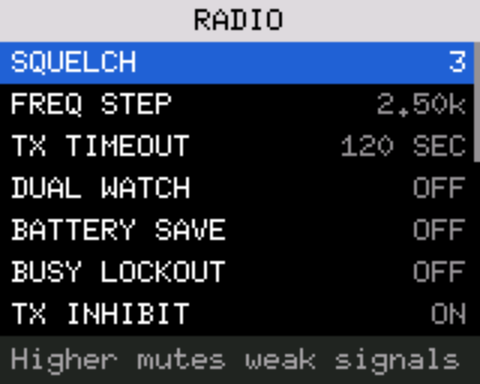

### Changing a value

1. Move to a setting with `UP` and `DOWN`. The strip under the list explains it in plain words, and for BATTERY SAVE, TX
   INHIBIT, TX BANDS, ROGER BEEP, SCAN RESUME and the key settings it says what the *current value* does.
2. Press `MENU`. The row turns amber with `^` and `v` around the value, and the strip shows `#default MENU ok EXIT undo`.
3. `UP` and `DOWN` change the value. `0` sets the first choice (OFF, NONE, the lowest). `#` puts the value **back to its
   default**.
4. `MENU` keeps the change; `EXIT` undoes it and puts the old value back. The new value already works while you are choosing
   it; `EXIT` restores the old one.


* `#` is itself a change: nothing is saved until `MENU`. It never loosens a transmit restriction. TX INHIBIT goes to ON. TX BANDS
  goes back to FCC HAM only from FCC HAM or ALL; from any other choice the strip says `Choose TX BANDS by hand` and nothing changes.
  BATTERY CAL goes back to the nominal 2537, which throws away a calibration you made with a voltmeter. `#` does nothing on VERSION,
  RF CHIP ID, GRID LOCATOR and RESET ALL.
* **`0` is not safe on TX INHIBIT:** while changing it, `0` selects OFF. `MENU` must still confirm, but take care.
* Typed settings (RPT OFFSET, BATTERY CAL, LATITUDE, LONGITUDE): `MENU`, type digits, `MENU`. `EXIT` deletes a digit, and leaves
  when nothing is typed. In LATITUDE and LONGITUDE `*` switches N and S, or E and W; latitude is two whole digits and four
  decimals (`407100` is 40.7100 N), longitude three and four. BATTERY CAL asks for the true battery volts as three digits
  (`785` is 7.85 V), and works out the calibration from them.
* A scroll mark appears at the right edge of any list of more than seven rows.
* FREQ STEP, BANDWIDTH, TX POWER, RX TONE, TX TONE, RPT SHIFT, RPT OFFSET and ANI CALL belong to the frequency on the main screen
  (the source calls them RAM-only), not to the saved settings record.
* **RESET ALL:** `MENU` turns the row amber and shows `HOLD #`. A second `MENU` does nothing, so a double press cannot reset the
  radio. **Hold `#`** to erase the saved VFO data, the settings record, the saved channel state and the stock FM list, and restart. Channels, the channel
  details and the FM station names are kept. After a reset TX INHIBIT is on again. `EXIT` cancels.

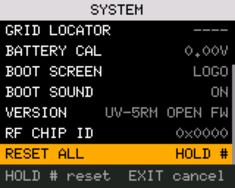

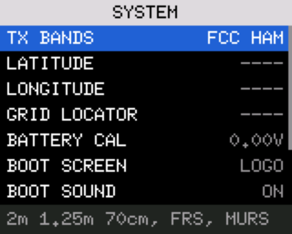

### Presets

PRESETS changes several settings at once. `MENU` on a preset opens a **preview** titled with the number of changes (`QUIET: 3
CHANGES`) that lists exactly what would change as `OLD>NEW`; settings already at the preset's value are left out. `MENU` applies it
(`PRESET APPLIED`); `EXIT` cancels. A preset with nothing to change shows `ALREADY SET`. Applying one is a one-time change: the
settings stay ordinary settings afterwards.

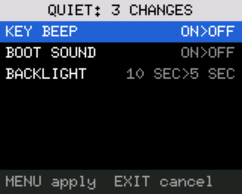

| Preset | Sets |
|---|---|
| QUIET | KEY BEEP off, ROGER BEEP off, BOOT SOUND off, BACKLIGHT 5 SEC |
| BATTERY SAVER | BATTERY SAVE 3, BACKLIGHT 5 SEC, DUAL WATCH off, VOX off |
| SCANNING | SCAN RESUME CARRIER, SQUELCH 4, BACKLIGHT 15 SEC |
| REPEATER | BUSY LOCKOUT on, SQ TAIL ELIM on, TX TIMEOUT 60 SEC, VOX off |
| DEFAULTS | SQUELCH 3, DUAL WATCH off, BATTERY SAVE off, KEY BEEP on, BACKLIGHT 10 SEC, SCAN RESUME CARRIER, VOX off, SQ TAIL ELIM on, ROGER BEEP off |

A preset **never** touches TX INHIBIT, TX BANDS, the saved position, the key assignments, BATTERY CAL, the boot text and tune,
or anything that belongs to the frequency on the main screen. A unit test checks the settings record byte by byte. DEFAULTS
restores only the settings in its row; RESET ALL is the one that erases things. Presets that follow what the radio is doing
(low battery, on the charger) would need the core; none exists.

### About (VERSION)

`MENU` on SYSTEM > VERSION or RF CHIP ID opens a read-only view titled `ABOUT`. It is a different part of the SETTINGS app, so
it takes a moment to appear. `UP` and `DOWN` move its cursor; `EXIT` or `MENU` goes back.

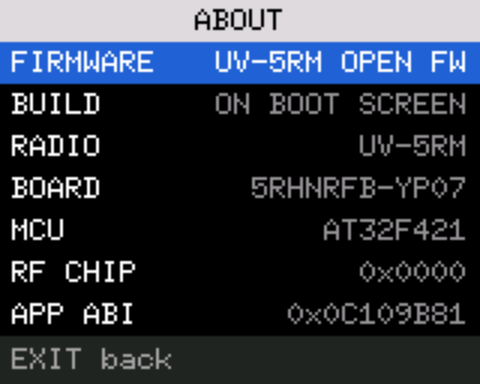

| Row | Shows |
|---|---|
| FIRMWARE | `UV-5RM OPEN FW` |
| BUILD | `ON BOOT SCREEN`: the commit is drawn on the boot screen (BOOT SCREEN must be LOGO); apps cannot read it |
| RADIO, BOARD, MCU | `UV-5RM`, `5RHNRFB-YP07`, `AT32F421` (fixed text, not asked of the radio) |
| RF CHIP | The chip id as the firmware reads it |
| APP ABI | The interface hash this firmware was built with. An app runs only if it was built with the same value |

### Grid locator

SYSTEM > GRID LOCATOR shows the six-character Maidenhead locator of the stored position (`EM12kx`, or `----` when none is
stored). `MENU` opens an entry screen where you type a locator instead of latitude and longitude; `MENU` sets both to the
**middle** of the square you typed. Four characters (`EM12`) or six (`EM12kx`): two letters, two digits, two letters.

* Digits go straight in. Letters are typed as on a phone: `2` is A B C, `3` D E F, `4` G H I, `5` J K L, `6` M N O, `7` P Q R S,
  `8` T U V, `9` W X Y Z. Press the same key again for the next letter; a different key, or `#`, accepts the letter. `EM12kx` is `3 3`,
  `6`, `1`, `2`, `5 5`, `#`, `9 9`.
* A place takes only the letters that belong there (A to R first, A to X last). Other keys are ignored.
* `EXIT` deletes the letter being chosen or the last character; with nothing typed it goes back unchanged. `MENU` with anything
  but four or six characters says `Need 4 or 6 characters`.

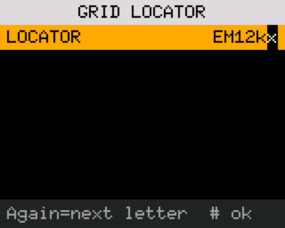

## CHAN MGR

CHAN MGR (slot 2) lists, edits, adds and deletes channels, one channel group at a time. It is two programs that hand over to
each other (the list, and the editor): opening a channel takes a moment longer than moving in the list.


**The list.** The title is `GROUP 1: REPEATERS`; the digit is the one that picks the group from the BAND menu (groups 10 to 15
show their number too). It opens on the radio's current group. **`*` steps to the previous group and `#` to the next.** Each
row is the channel number the main screen shows, the name and the receive frequency; the last row is `+ NEW`. `UP`, `DOWN` move;
`MENU` opens the channel, or starts a new one on `+ NEW`; `EXIT` leaves. A new channel goes into the group's first empty slot,
starting from the frequency on the main screen, LOW power and IN SCAN LIST on; if the group is full, nothing happens and no
message is shown. A group with nothing stored shows only `+ NEW`.


**The editor.** The title is the group and the channel's number (`REPEATERS 02`); a new channel reads `NEW REPEATERS 03`.

| Field | What it is |
|---|---|
| FREQUENCY | Receive frequency. Type three digits of MHz and five of decimals (`14652000` is 146.52000 MHz); accepted at the eighth digit, or `MENU` earlier (missing digits count as zeros) |
| RPT SHIFT, RPT OFFSET | OFF, `+` or `-`; the shift, three digits of MHz and four of decimals (`0006000` is 0.6000). The transmit frequency follows |
| RX TONE, TX TONE | OFF, a CTCSS tone or a DCS code |
| TX POWER | HIGH, LOW or MID |
| BANDWIDTH | WIDE or NARROW |
| IN SCAN LIST | Whether scanning visits this channel |
| BUSY LOCKOUT | Stored in the channel; **the core does not read it** (see the note below) |
| ANI CALL | `#1` to `#20` (a DTMF contact) or NONE |
| NAME | Up to 12 characters |
| SAVE | Writes the channel |
| (blank row) | Never selected: it keeps DELETE away from SAVE |
| DELETE | Only for channels that already exist |


`UP`, `DOWN` move between fields (wrapping, skipping the blank row), `MENU` starts changing a field, `EXIT` goes back to the list
**on the row you came from**. The strip reads `MENU edit    EXIT back` (on SAVE `MENU save`, on DELETE `MENU delete`); once anything has been
changed `back` becomes `discard`.

* **Unsaved changes.** `EXIT` leaves at once if nothing changed. If something did, the row turns amber and reads `DISCARD
  CHANGES?` (strip `MENU discard  EXIT keep`). `MENU` throws the changes away. `EXIT` goes back to editing with the changes
  still there; **other keys do nothing**. Use SAVE to keep them. A field set back to its old value is no change, and typing over a
  stock `FF`-padded blank name that reads the same is none either.
* **Choice fields** (shift, tones, power, bandwidth, scan list, busy lockout, ANI call): `UP`/`DOWN` change, `MENU` keeps, `EXIT`
  undoes, `0` selects the first choice. Strip `UP/DN  MENU ok  EXIT undo`. FREQUENCY and RPT OFFSET: `0-9 type MENU ok EXIT del`;
  `EXIT` deletes a digit, or cancels when none is typed.
* **SAVE** writes the channel and returns to the list on it, with a green `SAVED 01` for about a second and a half or until a key.
* **DELETE** is the last row. `MENU` arms it (the row turns amber and reads `HOLD #`; strip `HOLD # delete EXIT cancel`). **Hold
  `#`** to erase the channel; you return to the list with no notice. A second `MENU` or a short `#` does nothing; `EXIT` cancels.

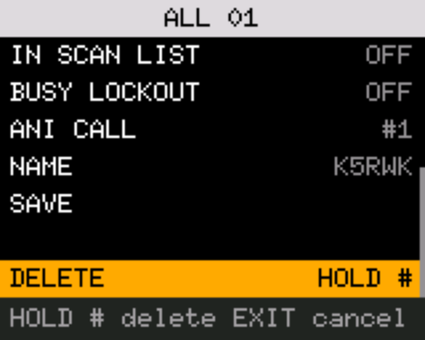

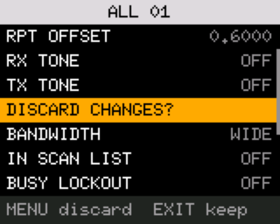


**Naming.** Select NAME and press `MENU`: a cursor appears. Letters are typed as on an old phone: press a key repeatedly to
step through its characters; wait about a second or press another key to fix the letter.

| Key | Characters, in the order they come up |
|---|---|
| `0` | space |
| `1` | `,` `.` `?` `1` |
| `2` | `A` `B` `C` `a` `b` `c` `2` |
| `3` | `D` `E` `F` `d` `e` `f` `3` |
| `4` | `G` `H` `I` `g` `h` `i` `4` |
| `5` | `J` `K` `L` `j` `k` `l` `5` |
| `6` | `M` `N` `O` `m` `n` `o` `6` |
| `7` | `P` `Q` `R` `S` `p` `q` `r` `s` `7` |
| `8` | `T` `U` `V` `t` `u` `v` `8` |
| `9` | `W` `X` `Y` `Z` `w` `x` `y` `z` `9` |

`UP` and `DOWN` move the cursor, `EXIT` deletes the character before it, `MENU` accepts the name (still not saved until SAVE), and a
**held `EXIT`** leaves without accepting. The strip reads `0-9 UP/DN MENU ok EXIT del`. A name holds 12 characters.


> **Busy lockout, as the code stands.** Only the BUSY LOCKOUT setting in SETTINGS > RADIO blocks PTT while the channel is busy
> (`CHANNEL BUSY`). The per-channel BUSY LOCKOUT field is stored but nothing in the core reads it. The editor accepts any
> frequency, including ones the receiver does not cover.

## SEARCH/QT SCAN

SEARCH/QT SCAN (slot 3) is one app with two screens, QT SCAN (it opens there) and SEARCH. `1` switches between them. It only
receives.

**QT SCAN** listens on the main-screen frequency. When a signal opens the squelch it reads the CTCSS tone or DCS code it
carries: `WAITING...`, `DETECTING...`, `FOUND`.


| Key | Action |
|---|---|
| `UP`, `DOWN` | Start detecting again (when a tone was found) |
| `MENU` | When found: use the tone as the receive tone (and as the transmit tone if it is CTCSS) on the main screen's current setup, and leave. In VFO mode it is kept with the VFO; in memory mode it is **not** written to the channel |
| `1` | Switch to SEARCH |
| `EXIT` | Leave |

**SEARCH** finds the frequency of a nearby transmitter by counting its carrier and then reads its tone (`HUNTING...`, `LISTEN`,
`FOUND`).


| Key | Action |
|---|---|
| `A/B` | Next band: UHF, VHF, 220M, 350M |
| `UP`, `DOWN` | Start again (when found) |
| `MENU` | When found: put the main screen in VFO mode on that frequency with the tone found, and leave |
| `1` | Switch to QT SCAN |
| `EXIT` (pressed or held) | Leave |

## SPECTRUM

SPECTRUM (slot 4) draws signal strength over a stretch of spectrum with a waterfall under it. It opens centred on the main-screen
frequency and only receives.


The light title bar shows the start and stop frequency. The strongest signal above the red dashed trigger line gets an amber
triangle, and the line under the waterfall reads `PEAK` with its frequency and level. The line under that shows `ST` (step), `B`
(bins), `D` (dwell), `T+` (trigger margin, dB), `C` (top of the scale, dBm), `G` (gain: a number, or `A` for automatic) and an
`A` when auto-listen is on. The strip says what `MENU` will do.

**`MENU` tunes the VFO to the marked peak and leaves SPECTRUM.** The active side switches to VFO mode on that frequency with no
tone, and the memory channel it was on is left unchanged. With nothing above the trigger line, `NO SIGNAL` shows and SPECTRUM
stays open. The frequency is the sweep's own grid point (a step of `ST` from the centre you opened it on), so with a coarse step
it can be a few kHz off the signal. "Strongest" is the highest of the latest reading of every bin.

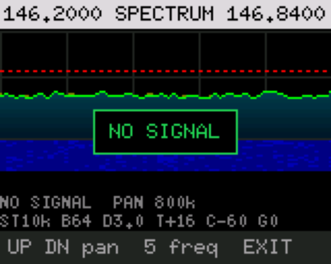

**`A/B` turns auto-listen on or off.** With it on the sweep stops on the strongest signal above the trigger and plays its audio.
Any key stops the listening first; `MENU` then tunes to the strongest bin above the trigger line, which is normally the one you
were hearing (the strip says `MENU tune here` while listening).

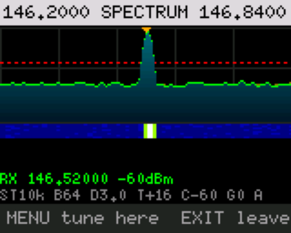

| Key | Action |
|---|---|
| `MENU` | Tune the VFO to the marked peak and leave (or `NO SIGNAL`) |
| `UP`, `DOWN` | Move the window by the pan step |
| `1`, `7` | Larger, smaller scan step |
| `2`, `8` | Larger, smaller pan step |
| `3`, `9` | Raise, lower the top of the scale |
| `*`, `#` | Raise, lower the trigger margin |
| `4` | Cycle the number of bins (128, 64, 32, 16) |
| `5` | Type a centre frequency (six digits, MHz with three decimals), `MENU` to accept |
| `0`, `6` | Longer, shorter dwell per bin |
| `A/B` | Auto-listen on or off |
| `SIDE1` | Ignore the marked bin (a signal spills into the bins next to it: press again for each) |
| `SIDE2` | Step the fixed gain through its choices, then back to automatic |
| `EXIT` | Leave without tuning |

## BAND SWEEP

BAND SWEEP (slot 5) makes repeated passes over a whole band, much wider than SPECTRUM, and keeps a list of the strongest
frequencies it found. It only receives. Bands: VHF (136 to 174 MHz), UHF (400 to 520), AIR (118 to 137), 220 (200 to 260), 350 (300
to 390) and a custom range.


The title bar shows the start and stop of the band and its name. The line under the list shows the step (`ST25K` or `ST12.5K`),
`T+` (detection margin), `D` (dwell) and `P` (pass number and time). The selected hit is blue and the trace is green.

**`MENU` hears the selected hit** (an `RX` line with its frequency and level). **`MENU` again tunes the main screen's VFO to it (no
tone) and leaves**; `EXIT` goes back to the sweep instead.

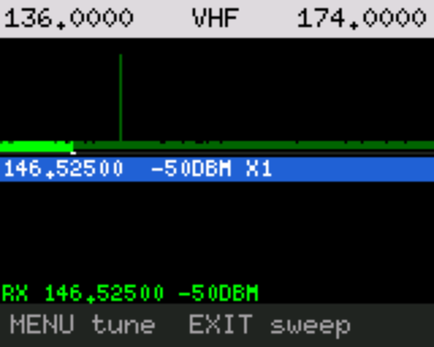

| Key | Action |
|---|---|
| `UP`, `DOWN` | Select a hit (holding repeats) |
| `MENU` | Hear the selected hit; again: tune the VFO to it and leave |
| `EXIT` | While hearing: back to the sweep. Otherwise: leave |
| `A/B` | Next band (VHF, UHF, AIR, 220, 350) |
| `1` | Step 25 kHz or 12.5 kHz |
| `5` | Type a custom range: start, `MENU`, stop, `MENU` (six digits each, MHz with three decimals; 16 to 560 MHz) |
| `0`, `6` | Longer, shorter dwell |
| `*`, `#` | Raise, lower the detection margin |
| `SIDE1` | Remove the selected hit |

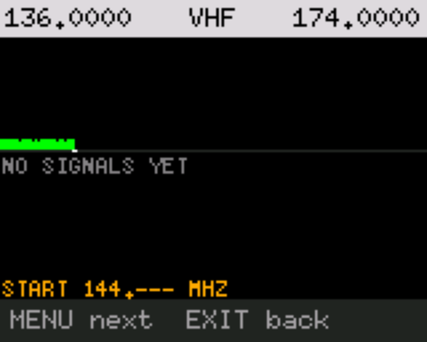

The list shows the sweep's grid frequency, which can be a few kHz off the signal's true frequency (AUDIT 16).

## FOX HUNT

FOX HUNT (slot 6) is a large signal meter that says whether a transmitter is getting stronger or weaker, and a rough distance
once you have calibrated it. It only receives. It starts on the main-screen frequency with the audio on and the backlight held
on. Its look is older than the shared one (dark red title bar).


| Key | Action |
|---|---|
| `1` | Audio on or off (`MUTED` shows) |
| `5` | Type a frequency (six digits, MHz with three decimals; 16 to 560 MHz), `MENU` to accept |
| `MENU` | Calibrate the distance: at a known distance from the signal press `MENU`, type the distance in tenths of a mile (`10` is 1.0 mile), `MENU`. It needs a signal first (`NEEDS A SIGNAL FIRST`) |
| `0` | Reset the calibration and the peak |
| `EXIT` | Leave (from an entry screen: back to the meter) |

The word under the bar says how the signal is changing: `CLOSER +`, `FARTHER -`, `SAME`, `MEASURING`, `TOO STRONG`. After
calibration it shows a range such as `ABOUT 0.3-0.5 MI`, from 20 dB per tenfold distance in the open and about 40 dB in clutter,
or `UNDER 0.1 MI`. Treat it as a guide only.


## RPT FINDER

RPT FINDER (slot 7) looks for a repeater's input. While someone talks on the repeater's output, it checks the usual input
frequencies for the same traffic and tries to read the tone. It only receives. Tune the main screen to the repeater's **output**
frequency first. Its look is older than the shared one.


It checks -600 and +600 kHz (144 to 148 MHz), -1.6 MHz (222 to 225 MHz), -5 and +5 MHz (420 to 450 MHz) and +5 MHz for GMRS
repeater outputs. The status line reads `NO STANDARD OFFSET`, `CHECKING INPUTS`, `WAITING FOR TRAFFIC`, `READING TONE`. Each
candidate shows how often it was seen and its tone (`NO TONE`, `TONE --` or for example `100.0Hz`).

| Key | Action |
|---|---|
| `UP`, `DOWN` | Switch between the two candidates |
| `MENU` | Once a candidate has been seen, ask for a channel number to save it to |
| `EXIT` | Leave |


To save, type the radio's own channel number from 1 to 1000 (up to four digits) and press `MENU`. The channel gets the output as
its receive frequency, the input as its transmit frequency, the tone, LOW power, narrow if the radio was narrow, scan on, and the
name `RPT 146.940`. **It never overwrites a channel**: if the number is in use it shows `CH n IN USE`; a bad number shows `BAD
CHANNEL`; success shows `SAVED TO CH n`. Pick a number inside the REPEATERS range (234 to 304 or 327 to 344) if you want it in that
group. How quickly it concludes on real repeaters is unknown (in the simulator, with simple on/off traffic, it was still checking
after two minutes).

## FSK PROBE

FSK PROBE (slot 8) is a bring-up tool for people debugging the radio chip's FSK modem, not for ordinary use: does the modem hear
anything, and what do its registers say? It only receives. It starts on 404.800 MHz (the Fort Worth radiosonde) at 4800 baud with the
RS41 frame header as the sync word, a four-byte sync match and frames of 316 bytes after the sync (158 words). The title bar is dark
red and says `RX ONLY`. The crystal, the sync words, the bit order and whether the modem hears a real signal at all are
**unverified on this radio**; the test steps are in [SONDE-APP.md](SONDE-APP.md) and the register notes in
[HARDWARE.md](../HARDWARE.md).


The counters are `SYN` (syncs), `WRD` (words), `FRM` (whole frames) and `CUT` (frames that stopped early). The row near the bottom
lists five options, `LEN` (316, 256 or 2048 bytes), `TH` (words per interrupt, 1 or 4), `INV` (invert received data), `BW` (receive
bandwidth 2.4 or 1.2) and `S` (sync length, 4 or 2 bytes); the selected one is yellow.

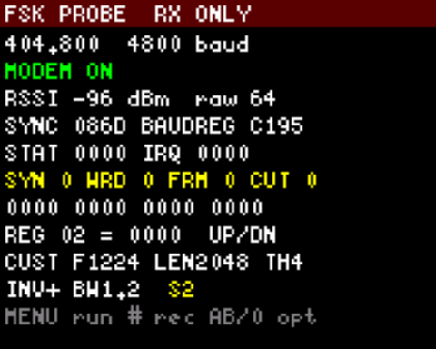

| Key | Action |
|---|---|
| `MENU` | Modem on or off |
| `*` | Next frequency (404.800, 144.390, 146.520, 446.000, 434.714 MHz) |
| `1` to `4` | Baud rate 450, 1200, 2400, 4800 |
| `5` to `9` | Sync word: `7E7E`, `2DD4`, `AAAA`, the RS41 header (`8`), the RS41 header in the other bit order (`9`) |
| `A/B` | Pick which option `0` changes |
| `0` | Change that option; the modem is reconfigured at once |
| `UP`, `DOWN` | Pick the register shown at the bottom |
| `#` | Start a capture, or stop the one running |
| `EXIT` | Modem off (ending any capture) and leave |

**Capture.** `#` records every word the modem delivers, with its time, sync flag and signal strength. The screen shows `ERASING` for a
moment (the app erases 32 sectors of flash first), then `REC` with a count, and `SAVED` with the total when `#`, `MENU` or `EXIT` ends it.
While it runs only `MENU`, `UP`, `DOWN`, `#` and `EXIT` work, so frequency, baud, sync and options cannot change. It holds 16,352
records (about 55 seconds of continuous 4800 baud), then shows `REC FULL`. It can only write inside its own 128 KB of the radio's
flash (0x1B0000 to 0x1D0000); any other address faults the app instead of writing. Each capture replaces the last.

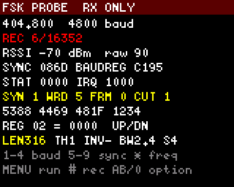

To copy a capture to the computer, leave the app (the radio must be on its main screen) and run:

```
python3 firmware/source-changes/probe_capture.py PORT my-capture.bin
```

It prints a summary (records, syncs, time between words, signal strength, the options recorded in the header) and writes
`my-capture.csv` beside the file. It only reads, and only that range, and never overwrites an existing file.

## FM

FM (slot 9) is the broadcast receiver, 87.5 to 108.0 MHz, with a list of saved stations that can have names. Broadcast FM uses a
separate tuner chip, so it is an app and not a VFO band. Typing a frequency in that range on the main screen opens it already tuned
(`098100` opens it on 98.1). Opened from the APPS list it starts on 100.0 MHz. **Nothing about this app has been seen on the radio**;
the pictures are from the simulator, which has a made-up tuner (signals at 90.1, 94.5, 98.1, 101.1 and 104.5 MHz) and a made-up station
list.


The tuner shows the frequency in large digits, the station's name and detail line (a format or a city; `Not saved` when the
frequency is not in the list) and a scale along the bottom with a mark per saved station and a marker at the tuned frequency. The
four bars at the right of the title bar are the signal strength.

| Key | Action |
|---|---|
| `UP`, `DOWN` | Tune 0.1 MHz up or down (holding repeats; wraps at the ends of the band) |
| Hold `UP`, `DOWN` | Seek to the next signal. `SEEKING` shows and only `EXIT` is heard until it ends (it gives up after three seconds) |
| `#`, `*` | Jump to the next, previous saved station by frequency (`NO SAVED STATIONS` if none) |
| `0` to `9` | Type a frequency, shown in amber: `981` is 98.1 MHz, `1015` is 101.5. Three digits are taken as soon as a fourth could not make a valid frequency (`981` yes, `100` waits for a fourth); `0981` also works. Outside 87.5 to 108.0: `RANGE 87.5-108.0` |
| `MENU` | Open the station list |
| `EXIT` | Clear a half-typed number, otherwise leave |

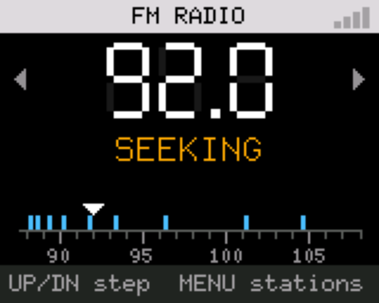

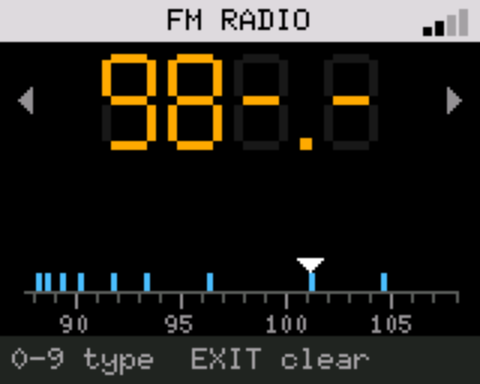

**The station list** (title `STATIONS`, `MENU`) is a list like the others: blue is your row, a speaker marks the station that is
playing, the frequency is on the right, and it opens on the station that is playing.

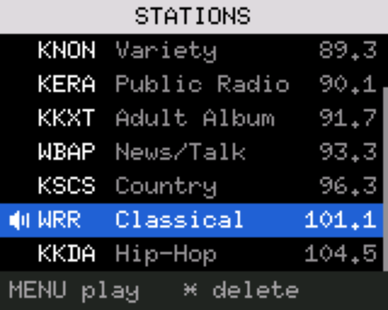

| Key | Action |
|---|---|
| `UP`, `DOWN` | Move |
| `MENU` | On a station: tune to it and go back to the tuner. On `+ SAVE THIS`: save the tuned frequency |
| `*` | On a station: arm a delete (the row turns amber). `MENU` confirms; `EXIT` or a move cancels |
| `EXIT` | Back to the tuner |

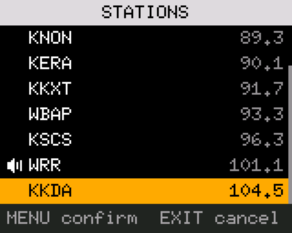

`+ SAVE THIS` is the first row whenever the tuned frequency is not in the list. Notices: `SAVED`, `DELETED`, `LIST FULL`.

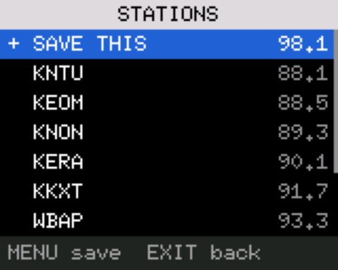

A station saved on the radio has no name (the list shows `(unnamed)`); names come from the computer, below. New stations go at the
end, so the list keeps the order of the file it came from, not frequency order. It holds 127 stations. Without a table the app
shows the 30 bare frequencies the stock list held, and the first save or delete moves them into a table.

**Station names from a computer.** Write the stations as a CSV (a CHIRP export works: only `Name`, `Frequency` and `Detail` are read;
`channels/fm/dallas.csv` is an example, and nothing about it is built into the app) and install it. The installer's step 5 does it;
by hand:

```
python3 firmware/source-changes/fm_stations.py build my-stations.csv -o build-out/my-stations.fmst
python3 firmware/source-changes/fm_stations.py install PORT build-out/my-stations.fmst --before build-out/fm-before.bin
```

A name is at most 12 printable ASCII characters (it is not cut: the build fails), a detail at most 16, the frequency a multiple of
0.1 MHz from 87.5 to 108.0, at most 127 stations. **Installing replaces the whole list, including stations saved on the radio**
(`--before` keeps a copy; `fm_stations.py show FILE` reads one). It needs a core that has the `F` programming-port command; an older
core answers with an error and nothing is written. RESET ALL clears the stock 30-station list, not this table. Not tried on a radio.

## HAM TOOLS

HAM TOOLS is an *extra* (not in a slot by default). Four small tools: station-ID timer, stopwatch, wavelength calculator and
grid locator. It only receives. `A/B` moves to the next tool. **Leaving the app loses the timers.** While the ID timer is armed or
the stopwatch is running, a short `EXIT` only shows `HOLD EXIT: TIMER RUNS`; **hold `EXIT`** to leave. It has its own look (dark
red title bar).

| Tool | Keys |
|---|---|
| ID TIMER | `MENU`: "I just identified", restart the countdown. `*`: arm or disarm (and restart). `UP`, `DOWN`: set the interval, 1 to 30 minutes in 1-minute steps, only while disarmed. Default 10 minutes. When overdue it shows `ID NOW`, holds the backlight on and beeps every 30 seconds (the beep follows KEY BEEP) |
| STOPWATCH | `MENU`: start or stop. `*`: lap (the last four are shown). `0`: reset |
| WAVELENGTH | Type the frequency in kHz (six digits). `*` clears. Shows the full, half and quarter wave and a quarter wave at velocity factor 0.95 |
| GRID LOCATOR | Shows the Maidenhead locator of the position in SETTINGS > SYSTEM; `NO POSITION SET` until you enter one |


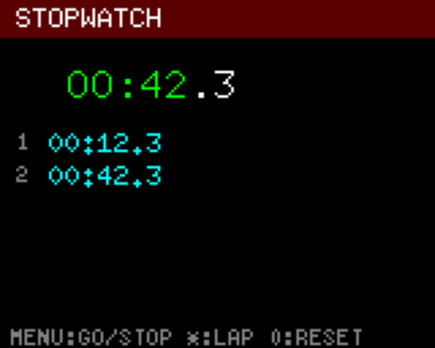


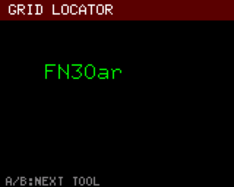

## TEXT

TEXT is an *extra* (not in a slot by default). It sends short text messages between two radios using the radio chip's FSK modem.
**It transmits.** Both radios must run TEXT on the same frequency, the one on the main screen when you open the app. The light title
bar shows the frequency and `LOW` or `HIGH` power, and **turns red and reads `TX` only while the transmitter is actually keyed**.

> **A radio with TEXT open answers messages by transmitting on its own.** A message is repeated up to eight times until the other
> radio confirms it. Use it only on a frequency where you are licensed and permitted to send digital data, on simplex. TEXT has
> never been tested on the air: the simulator transmits into a model.


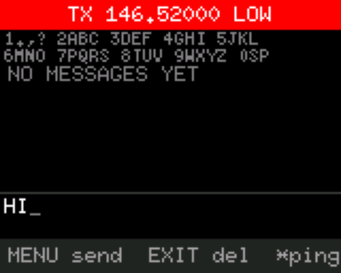

| Key | Action |
|---|---|
| `0` to `9` | Type with the multi-tap keys, upper case only: `0` is space (again: the digit 0), `1` gives `. , ? ! - / 1`, `2` `A B C 2`, `3` `D E F 3`, `4` `G H I 4`, `5` `J K L 5`, `6` `M N O 6`, `7` `P Q R S 7`, `8` `T U V 8`, `9` `W X Y Z 9`. The letter is fixed after about a second. A message holds 50 characters |
| `MENU` | Send the typed message (`TYPE A MESSAGE FIRST` if empty) |
| `*` | Send a numbered test message (`PING 1`, `PING 2`, ...) |
| `A/B` | Switch between LOW and HIGH power |
| `UP`, `DOWN` | Scroll the message list |
| `EXIT` | While sending: stop retrying (`STOPPED: NOT CONFIRMED`). Otherwise delete the last typed character; with nothing typed, leave |
| Hold `EXIT` | Leave |
| Hold `#` twice | Erase all stored messages (the first hold asks `HOLD # AGAIN TO ERASE ALL`) |

Messages are kept in the radio's flash (256 of them) until overwritten or erased. Notices include `NEW MESSAGE`, `DELIVERED`,
`NOT CONFIRMED`, `MESSAGE FULL`, `TX FAILED: NO DONE FLAG` and `TX BLOCKED: SEE SETTINGS` when TX INHIBIT or TX BANDS stops it.

## Settings reference

Every setting in SETTINGS, with its values, the value a new settings record has (the radio's factory-reset state, checked
against the core by a unit test), and the line the radio's own help strip shows for it. Press `#` while changing a setting to
return to the default. The source for this table is `firmware/firmware-source/apps/settings/common.rs`.

### RADIO

| Setting | Values | Default | The radio says |
|---|---|---|---|
| SQUELCH | 0 to 9 | 3 | `Higher mutes weak signals` |
| FREQ STEP | 2.50k, 5.00k, 6.25k, 10.00k, 12.50k, 20.00k, 25.00k, 50.00k, 100.00k | 10.00k | `Step when tuning the VFO` |
| TX TIMEOUT | OFF, then 15 to 180 SEC in steps of 15 | 120 SEC | `Stops TX after this time` |
| DUAL WATCH | OFF, ON | OFF | `Listen to both A and B` |
| BATTERY SAVE | OFF, 1 to 4 | OFF | per value: `Listens 0.1s, sleeps 0.1s` ... `0.4s`; OFF: `Receiver always listening` |
| BUSY LOCKOUT | OFF, ON | OFF | `No TX while channel busy` |
| TX INHIBIT | OFF, ON | **ON** | `Radio will not transmit` (ON), `TX allowed within TX BANDS` (OFF) |
| BANDWIDTH | WIDE, NARROW | WIDE | `WIDE 25k or NARROW 12.5k` |
| TX POWER | HIGH, LOW, MID | LOW | `Lower power saves battery` |
| RX TONE | OFF, a CTCSS tone or a DCS code | OFF | `Hear only calls with tone` |
| TX TONE | OFF, a CTCSS tone or a DCS code | OFF | `Tone sent with your TX` |
| RPT SHIFT | OFF, +, - | OFF | `Repeater TX is + or - RX` |
| RPT OFFSET | typed, in MHz | 0.0000 | `Repeater TX gap, in MHz` |
| SCRAMBLER | OFF, 1 to 3 | OFF | `Voice scramble, must match` |
| SCAN RESUME | TIMED, CARRIER, STOP | CARRIER | `Waits a bit, then moves on` (TIMED), `Holds until signal ends` (CARRIER), `Stops at the first signal` (STOP) |
| RIT | -1270 to +1270 Hz in steps of 10 | 0 | `Fine RX tune, USB only` |
| CH DISPLAY | FREQUENCY, NAME, NAME+FREQ | NAME+FREQ | `Channel shows freq or name` |

The VFO's own values (FREQ STEP, BANDWIDTH, TX POWER, RX TONE, TX TONE, RPT SHIFT, RPT OFFSET) start at the defaults above when the
radio is reset. RIT acts only in USB.

### AUDIO

| Setting | Values | Default | The radio says |
|---|---|---|---|
| KEY BEEP | OFF, ON | ON | `Beep on keys and alerts` |
| VOX | OFF, ON | OFF | `Talk to transmit, no PTT` (the same TX INHIBIT and TX BANDS rules apply) |
| VOX LEVEL | 1 to 9 | 1 | `1 most sensitive, 9 least` |
| VOX DELAY | 0.5 to 2.0 S | 1.0 S | `Keeps TX on after speech` |
| TONE BURST | 1000, 1450, 1750, 2100 Hz | 1750 Hz | `Pitch of the TX TONE key` (it is used only by the TX TONE key function) |
| SQ TAIL ELIM | OFF, ON | ON | `No squelch crash at TX end` |
| RPT TAIL DLY | OFF, 100 to 1000 MS | OFF | `Wait after TX before RX` |
| ROGER BEEP | OFF, ROGER, MDC1200 | OFF | `Nothing sent at TX end` (OFF), `Beep sent when you unkey` (ROGER), `Data burst sent at TX end` (MDC1200) |

### DISPLAY

| Setting | Values | Default | The radio says |
|---|---|---|---|
| BACKLIGHT | ALWAYS ON, 5, 10, 15, 20 SEC | 10 SEC | `Light-on time after a key` |
| AUTO KEYLOCK | OFF, 5, 10, 15 SEC | OFF | `Locks keys after idle time` |

### KEYS

Six assignable key presses. `BAND`'s short press always opens CH GROUPS and cannot be changed.

| Setting | Values | Default | The radio says |
|---|---|---|---|
| SIDE1 SHORT | a key function (below) | NONE | what the chosen function does |
| SIDE1 LONG | a key function | NONE | the same |
| SIDE2 SHORT | a key function | LIGHT | the same |
| SIDE2 LONG | a key function | NONE | the same |
| BAND LONG | a key function | NONE | the same |
| VFO/MR LONG | a key function | NONE | the same |

| Key function | What it does |
|---|---|
| NONE | Nothing |
| BANDWIDTH | Switches WIDE and NARROW (`Switches WIDE / NARROW`) |
| MONITOR | Opens the squelch on or off (`Squelch open on or off`) |
| AM/FM | Steps FM, AM, USB (`Steps FM, AM, USB`) |
| TX TONE | **Transmits** the TONE BURST tone while the key is held (`Transmits the TONE BURST`). Works only as a SHORT choice of `SIDE1` or `SIDE2`; as a hold it does nothing. TX INHIBIT and TX BANDS apply |
| SCAN | Starts scanning |
| TX POWER | Steps HIGH, LOW, MID |
| LIGHT | Flashlight on or off |
| REVERSE | Swaps the receive and transmit frequencies (`Swaps RX and TX frequency`) |
| APP 1 to APP 9 | Opens the app in that APPS list slot (`Opens the app in slot n`); nothing if the slot is empty. EXIT returns to the main screen |

The choices skip two retired values, so stepping never lands on a second NONE. The stored default of SIDE1 SHORT is one of the
retired values: it does nothing and shows as NONE.


### ANI / DTMF

| Setting | Values | Default | The radio says |
|---|---|---|---|
| ANI ON PTT | OFF, ON | OFF | `Sends your ID when you key` |
| ANI CALL | NONE, `#1` to `#20` | NONE | `Contact your ID goes to` |

### SYSTEM

| Setting | Values | Default | The radio says |
|---|---|---|---|
| TX BANDS | CE HAM, FCC HAM, GB HAM, 400-430, 400-438, PMR446, GMRS/FRS, CA HAM, NONE, ALL | **FCC HAM** | what the chosen choice allows (see [Transmit safety](#transmit-safety)) |
| LATITUDE | typed, degrees N or S | not set (`----`) | `For HAM TOOLS grid locator` |
| LONGITUDE | typed, degrees E or W | not set (`----`) | `For HAM TOOLS grid locator` |
| GRID LOCATOR | typed as a locator | `----` | `Sets LATITUDE + LONGITUDE` |
| BATTERY CAL | typed true battery volts | nominal 2537 | `Type true battery volts` |
| BOOT SCREEN | OFF, LOGO | LOGO | `Logo shown at power-on` |
| BOOT SOUND | OFF, ON | ON | `Start-up tune; needs LOGO` (it cannot be ON while BOOT SCREEN is OFF) |
| VERSION | opens the about view | | `MENU: about this firmware` |
| RF CHIP ID | opens the about view | | `Radio chip ID, for support` |
| RESET ALL | `MENU`, then hold `#` | | `Erases settings and VFOs` |

### PRESETS

| Setting | Values | Default | The radio says |
|---|---|---|---|
| QUIET | opens a preview | | `No beeps, short light` |
| BATTERY SAVER | opens a preview | | `Sleeps more, light short` |
| SCANNING | opens a preview | | `Scanning: stays on a call` |
| REPEATER | opens a preview | | `Polite repeater operating` |
| DEFAULTS | opens a preview | | `Defaults, except TX limits` |

Decisions still open for the owner (AUDIT 51): the FCC HAM default of TX BANDS includes FRS, GMRS and MURS; VOX LEVEL defaults
to the most sensitive; TX TIMEOUT defaults to 120 s; the `0` key can set TX INHIBIT to OFF while it is being changed. TONE BURST
feeds only the TX TONE key function. Nothing here has been measured on a radio.

## Transmit safety

PTT transmits only if **all** of these allow it, checked in this order. The first refusal is the notice you see.

1. **TX INHIBIT** (SETTINGS > RADIO). **On by default, and on again after RESET ALL.** While on, PTT shows `TX INHIBIT IS ON` and
   the radio does not transmit. Leave it on until there is a dummy load on the antenna port.
2. **The channel.** A memory channel with no transmit frequency is receive-only: `RX-ONLY CHANNEL`.
3. **BUSY LOCKOUT** (SETTINGS > RADIO), if on and a signal is present: `CHANNEL BUSY`.
4. **TX BANDS** (SETTINGS > SYSTEM). The set of frequencies the transmitter may use. **Default: FCC HAM.** Outside the chosen set,
   or in any mode but FM (AM and USB never transmit), PTT shows `OUTSIDE TX BANDS`.

TX TIMEOUT ends a transmission after the set time (default 120 seconds). PTT is ignored while scanning and in menus and apps
(an app that transmits, TEXT, applies the same inhibit and band rules and says `TX BLOCKED: SEE SETTINGS`). A hard fault, a panic or
an app fault switches the power amplifier off before anything else (see [Troubleshooting](#troubleshooting)); that has not been
tested with the transmitter keyed.

| TX BANDS | Transmit allowed on |
|---|---|
| CE HAM | 144 to 146 and 430 to 440 MHz |
| **FCC HAM** (default) | 144 to 148, 222 to 225 and 420 to 450 MHz; FRS/GMRS 462.550 to 462.725 and 467.550 to 467.725 MHz; MURS 151.820 to 151.940 and 154.570 to 154.600 MHz |
| GB HAM | 144 to 148 and 430 to 440 MHz |
| 400-430 | 137 to 174 and 400 to 430 MHz |
| 400-438 | 137 to 174 and 400 to 438 MHz |
| PMR446 | 446.00625 to 446.19375 MHz |
| GMRS/FRS | 462.550 to 462.725 and 467.550 to 467.725 MHz, and the five MURS frequencies (151.820, 151.880, 151.940, 154.570, 154.600) |
| CA HAM | 144 to 148 and 430 to 450 MHz |
| NONE | Nowhere: no transmitting on any frequency |
| ALL | 136 to 174 MHz **except the NOAA weather channels** (162.3875 to 162.5625 MHz are blocked), 220 to 260 and 400 to 520 MHz. Nothing below 136 MHz. These are the limits the stock firmware reports for this radio |

The same rule applies to VFO and memory channels, and there is no per-band power limit. The 400-430 and 400-438 choices are the
upstream mod's. ALL has not run on a radio and nobody has measured whether the transmitter is clean across 136 to 174, 220 to 260
and 400 to 520 MHz; choosing it is your decision and your responsibility. The radio does not know your licence.


## Loading from a computer

**The installer is the main path.** `install.py` backs the radio up, checks every file, flashes the core only if needed, then
writes apps, channels, channel details, FM stations and a boot screen, and verifies each by reading it back. Nothing is written
until you type `INSTALL`. Read [INSTALL.md](INSTALL.md) first (risks, cable, what it needs, recovery); the short form is:

```
python3 install.py --dry-run --port PORT       # everything except the writes
python3 install.py --port PORT                 # menus, then the real thing after you type INSTALL
```

**It has only been run against simulated radios, never a real one.** The tools it drives have each been used on the one radio, except
the channel loader after the sector fix, the details and FM writers and the boot-logo tool in their latest form (AUDIT 48).

The manual path is the individual tools, in the order of [FIRST-FLASH-RUNBOOK.md](FIRST-FLASH-RUNBOOK.md). What each load replaces:

| What | Tool | A load replaces |
|---|---|---|
| Core firmware | `flash_bf.py` (guided by the runbook; the installer does it) | The whole core. Settings, channels and calibration are kept (a core-to-core upgrade kept the settings once, AUDIT 30) |
| Apps | `install_apps.py PORT RELEASE_DIR [--dry-run]` | Each of the nine slots that differs; a slot the layout leaves empty is **erased** |
| Channels | `channel_plan.py build`, then `restore_backup.py PORT IMAGE --before UNDO.img [--write]` | The slots of the groups you load. It rewrites **whole 4 KB sectors** (128 channels) because the firmware erases a sector on the first write; unchanged channels in a touched sector are rewritten from the image, so use `--base` with a backup or channels outside your lists in those sectors are erased. A first run without `--write` is a dry run |
| Channel details | `channel_extras.py PORT TABLE.extras` | The **whole** details table (the text beside the number), built only from the lists you loaded: details of channels not in those lists disappear |
| FM station names | `fm_stations.py build` and `install` | The whole station list, including stations saved on the radio |
| Boot screen | `boot_logo_raw.py PORT LOGO.rgb565 BACKUP.rgb565` (`set_boot_logo.py` for photos) | The picture; the old one is saved first |
| Start-up tune | `set_boot_tune.py PORT BACKUP.bin doom` (or `mario`) | The tune bytes of the settings record only |
| Settings | the radio's own SETTINGS | Never written by any tool here |
| Calibration | none | Never written; the installer reads it before and after and stops if it changed |

**Channel lists.** `channels/` holds one CHIRP-format CSV per channel group: `weather.csv`, `frs.csv`, `gmrs.csv`, `murs.csv`,
`repeaters.csv`, `simplex.csv`, `satellites.csv` and `sonde.csv`. The file name says which group's slots it fills; names are at
most 12 ASCII characters and are never cut; the optional `Detail` column (16 characters) is the text beside the number on the
main screen. `repeaters.csv` and `gmrs.csv` are local to the Dallas area, so replace them with your own. See
[channels/README.md](../channels/README.md).

```
python3 firmware/source-changes/channel_plan.py build channels -o build-out/channels.img --base my-backup/NAME.img
python3 firmware/source-changes/restore_backup.py PORT build-out/channels.img --before build-out/undo.img            # dry run
python3 firmware/source-changes/restore_backup.py PORT build-out/channels.img --before build-out/undo.img --write    # writes
python3 firmware/source-changes/channel_extras.py PORT build-out/channels.extras --before build-out/extras-before.bin
```

FRS, GMRS and MURS lists are for listening unless your licence and the rules allow otherwise; TX BANDS and TX INHIBIT decide what
the radio will transmit.

**Boot screen and start-up tune.** The boot screen is a picture stored on the radio. To carry your callsign: copy `.env.sample` to
`.env` (git ignores it, so your details are never committed), fill it in, run `scripts/dev.sh personalize`, look at the preview, and
install the result with `boot_logo_raw.py` (or give it to the installer as a finished 160x128 RGB565 file). BOOT SCREEN must be LOGO and
BOOT SOUND ON for the picture and tune to appear.

## Backup and recovery

Follow [FIRST-FLASH-RUNBOOK.md](FIRST-FLASH-RUNBOOK.md); it starts with read-only steps and says what can and cannot be restored.
In short:

* **Back up before anything else** (`radio_read.py` on the stock firmware, `dump_nor.py` on this one; the installer does it for you),
  and make a second copy with CHIRP while the stock firmware is still on the radio.
* **There is no stock firmware image for this radio** (the YP07's chip is not the one in the published images). Flashing is
  effectively one way, and the bootloader is not overwritten, so another open build can always be flashed.
* Apps, the boot logo, channels, the VFO and the 20 DTMF contacts can be restored from a backup. Settings are not restored from a
  stock backup (re-enter them in SETTINGS). Calibration is never written, and cannot be restored if lost.
* Flash only an image built by `scripts/dev.sh release` whose hash equals `firmware/expected-hashes.json` (AGENTS.md); never the
  `.BF` committed in the repository (AUDIT 6).
* Keep TX INHIBIT on until a dummy load is on the antenna port. Never commit a backup (`my-backup/` is git-ignored).

## Troubleshooting

| What you see | What it means and what to do |
|---|---|
| Installer or tool says "re-seat the cable", or the radio shows its programming icon again and again | The plug is not fully in. A half-seated plug echoes the computer's own bytes back. Push it in until it is home and run again |
| The programming port does not answer | It answers only from the main screen of the radio. Leave any app and the menus first |
| The tool reports something odd after the cable was plugged in and the radio keyed up | The cable is for another radio (a PL2303 one did this). Unplug it and do not use it |
| `EMPTY` in the APPS list for apps you installed | The apps were built for a different core: `EMPTY` means the package is missing or its ABI hash differs. Reinstall the apps from the same release as the core (the installer's "always flash" core choice, or `install_apps.py` with that release folder). SETTINGS > SYSTEM > VERSION shows the hash the core expects |
| Red `APP DID NOT LOAD (n)` | See [the APPS list](#the-apps-list) for the code. 2 is the usual one: wrong core |
| A red screen titled `APP FAULT`, `APP CRASH` or `CORE FAULT` | The firmware stopped on purpose. It has already switched the power amplifier off. The second line says where: `SLOT 8 PANIC` or `SLOT 8 LINE 142` (the launcher slot of the app), `PC 0800 DA22` or `IRQ 7` (the core). It shows for about two and a half seconds and then the radio restarts; hold the power key to switch off instead. Write down the line and tell the project. If it recurs on every start, it will loop until you hold the power key. This screen has not been seen on a radio |
| A blank screen and no response | An older core hung when an app was opened (fixed; AUDIT 31) and a battery pull recovered it. Pull the battery. If it keeps happening note what you pressed before it |
| PTT does nothing, or a red box | Read the box; see [Transmit safety](#transmit-safety). With TX INHIBIT off, `OUTSIDE TX BANDS` also means the mode is AM |
| `NO CH IN ...` | The group has no stored channel. Choose ALL or load the group's list |
| A channel missing from memory mode | It is outside the current group's numbers. Choose ALL |
| `OUT OF RX RANGE` on a typed frequency | The receiver does not cover it (108 to 174, 200 to 260, 350 to 520 MHz); 87.5 to 108.0 opens the FM app instead |
| Keys do nothing | The keypad is locked (padlock in the status bar): hold `*` |
| A setting seems to have changed by itself | A preset or RESET ALL was applied, or the value was changed with `#` or `0` while changing it; presets never touch TX INHIBIT or TX BANDS |
| The installer finished but the radio's details or FM names changed | Loading channel lists replaces the whole details table, and an FM list replaces the whole station list; copies are kept in the backup folder |

Other documents: [INSTALL.md](INSTALL.md), [FIRST-FLASH-RUNBOOK.md](FIRST-FLASH-RUNBOOK.md), [RADIO-CHECKLIST.md](RADIO-CHECKLIST.md),
[HARDWARE.md](../HARDWARE.md), [AUDIT.md](../AUDIT.md), [CHANNEL-GROUPS.md](CHANNEL-GROUPS.md).
