# User guide

This guide describes the custom firmware for the Baofeng UV-5RM (board `5RHNRFB-YP07`) as it is in this repository today: the
screens, the keys, the settings and the apps. It is written for a licensed radio amateur, not a programmer.

Contents: [Status](#status-read-this-first) | [Keys](#the-keys) | [Main screen](#the-main-screen) |
[Channel groups](#channel-groups-the-band-key) | [APPS list](#the-apps-list-menu) | [SETTINGS](#settings) |
[CHAN MGR](#chan-mgr-the-channel-manager) | [Programmable keys](#assigning-the-side-keys-band-and-vfomr-long-press) |
[Transmit safety](#transmit-safety) | [Apps](#the-apps) | [Channel lists](#loading-channel-lists-from-a-computer) |
[Backup and flashing](#backing-up-and-flashing)

## Status: read this first

The firmware is an experiment. Only a small part of it has run on a real radio.

* **Run on a radio** (2026-11-11, one radio, the `aaa3e04` build, which is essentially the upstream mod's source built by this
  project's CI): it flashes, boots, receives (NOAA weather on 162.400 MHz was heard), and refuses to transmit by default,
  showing `TX PROHIBITED` when PTT is pressed (later builds give the reason instead, see below). The nine launcher apps were written to the radio and read back correctly.
* **Not yet run on a radio:** everything built since. That covers the readable setting names, the colour list style, the hint
  strip at the bottom of lists, channel groups in CHAN MGR, the VFO/MR long-press, the `SAVED` notice, the renamed TX BANDS setting and its `ALL` choice, and the channel lists in `channels/`. These pass the simulator and the tool tests on a computer. The
  simulator is a model: a screen that looks right in it can still look or behave differently on the radio.
* **Never tested on the air:** transmitting of any kind, including the TEXT app. The `AUDIT.md` rows 25 to 28 are the record.

Pictures in this guide are rendered by the simulator from the same screen-drawing code the radio uses. They are not
photographs of the radio. Where the simulator starts from an empty settings record, values in a picture (for example `CE HAM`
for TX BANDS) are not what a real radio shows; the text says so where it matters.

Some screens belong to the core firmware (the main screen, the APPS list, the CH GROUPS menu and the notices on the main
screen). The simulator does not draw them, so they have no picture here. They are described from the source code.

> **Wording in this guide follows the source in the working tree on 2026-11-11 (some of it not yet committed). Text on screen can change; the pictures are regenerated with `scripts/docs-screens.sh`.**

> **You are responsible for what you transmit.** The settings below can limit the transmitter, but they do not make a
> transmission legal. You need the right licence for the band and the right to operate on the channel. This radio is not
> certified for FRS, GMRS or MURS. See [Transmit safety](#transmit-safety).

## The keys

The radio's keys, as this firmware names them:

| Key | Notes |
|---|---|
| `MENU`, `EXIT` | Select and back, in every list. |
| `UP`, `DOWN` | Move in lists; step the frequency or channel on the main screen. Lists wrap around. |
| `0` to `9`, `*`, `#` | Digits, and the two keys at the bottom of the pad. |
| `VFO/MR` | Switch between VFO (frequency) mode and memory (channel) mode. |
| `A/B` | Switch between the two frequencies shown on the main screen. |
| `BAND` | Open the channel group menu (CH GROUPS). |
| `SIDE1`, `SIDE2` | The two small keys on the side. The source names them after the stock radio's FM and flashlight keys. |
| `PTT` | Transmit. |

A *short press* is an ordinary press; a *long press* is a press and hold. Beeps play on short and long presses unless
KEY BEEP is off.

### Keys on the main screen

| Key | Short press | Long press |
|---|---|---|
| `0` to `9` | Type a number. In memory mode: a channel number, accepted on the third digit, or press `MENU` after fewer digits. In VFO mode: a frequency of six digits, MHz with three decimals (`146520` is 146.520 MHz), accepted on the sixth digit. | |
| `UP` / `DOWN` | VFO mode: one frequency step. Memory mode: the next stored channel in the current group. Holding repeats. | |
| `EXIT` | Clears a half-typed number. | |
| `MENU` | Opens the APPS list (or accepts a channel number you have typed in memory mode). | |
| `VFO/MR` | Toggle VFO and memory mode. | Runs the function assigned to VFO/MR LONG (default: none). |
| `A/B` | Switch between the two frequencies. | |
| `BAND` | Opens the CH GROUPS menu. | Runs the function assigned to BAND LONG (default: none). |
| `*` | Starts typing a DTMF string to send with the next PTT. Hold `EXIT` to cancel. | Locks or unlocks the keypad. |
| `#` | | Starts scanning. |
| `SIDE1`, `SIDE2` | Run the function assigned to SIDE1 SHORT or SIDE2 SHORT. | Run the function assigned to SIDE1 LONG or SIDE2 LONG. |

With the keypad locked, only `SIDE1`, `SIDE2` and a long press of `*` still work. AUTO KEYLOCK (SETTINGS > DISPLAY) can lock
the keypad after 5, 10 or 15 seconds without a key press.

While scanning, `UP` and `DOWN` change the scan direction, `BAND` stops the scan and opens CH GROUPS, and `EXIT` or a long
press of `#` stops the scan. In memory mode the scan visits only the channels of the current group that have IN SCAN LIST set.

## The main screen

*No picture yet: the simulator does not draw the main screen.*

From the source, top to bottom:

* **Status bar.** On the left, small flags: `PS` (battery save is active), `DWR` (dual watch is on), `VOX`, and a padlock when
  the keypad is locked. While transmitting, a timer (`MM:SS`) replaces `PS` and `DWR`. To the right of the flags is the short
  name of the current channel group (`ALL`, `WX`, `RPT` and so on). On the right: battery voltage and a battery icon.
* **Two frequency blocks** (the two sides, switched with `A/B`). The one that is active has a red stripe at its left edge, and
  the stripe turns brighter red while transmitting. Each block has three rows: the label (`VFO`, or `M001` for memory
  channel 1) and the channel name; the frequency in large digits (with CH DISPLAY set to a name, the name instead of or
  beside the frequency); and a small line with the mode (`FM`, `AM`), power (`LOW`, `MID`, `HIGH`), tone mode (`Tone`, `TSQL`,
  `DTCS` and so on), repeater shift (`+` or `-`), bandwidth (`WIDE`, `NAR`) and `R` when reverse is on.
* **Markers at the left of a block:** `RX` while receiving, `TX` while transmitting, `>>` for the side that heard the last signal.
* **Signal meter** across the bottom: a bar of segments showing signal strength, or the microphone level while transmitting.
* **Notices** in a box in the middle of the screen. A red box appears when PTT is pressed and the radio will not transmit. It
  gives the reason: `TX INHIBIT IS ON`, `RX-ONLY CHANNEL`, `OUTSIDE TX BANDS` or `CHANNEL BUSY` (see
  [Transmit safety](#transmit-safety)); the build tested on the radio showed `TX PROHIBITED` for all of them. `NO CH IN ...` and `NO CHANNELS` (amber) are described in the next section.

Channel numbers on the main screen start at 1: `M001` is the first channel slot. CHAN MGR uses the same numbers.

## Channel groups (the BAND key)

A *channel group* is a named range of channel numbers. Choosing a group limits memory mode, `UP` and `DOWN` in memory mode, and
scanning to the channels in that range. The radio has 1,000 channel slots; the groups are:

| Group | Short name (shown on the main screen) | Channel numbers |
|---|---|---|
| ALL | ALL | 1 to 1000 |
| WEATHER | WX | 1 to 7 |
| POLICE FIRE EMS | PD/FD | 14 to 105 |
| FED & GOV | FED | 106 to 146 |
| UTILITIES | UTIL | 147 to 157 |
| RAILROAD | RAIL | 158 to 167 |
| AIR TRAFFIC | AIR | 168 to 233 |
| REPEATERS | RPT | 234 to 304 and 327 to 344 |
| FRS | FRS | 305 to 326 |
| GMRS | GMRS | 305 to 344 |
| MURS | MURS | 345 to 349 |
| FRS GMRS MURS | F/G/M | 305 to 349 |
| CUSTOM RANGE | RANGE | 1 to 1000 for the channel list; see below |

Groups may overlap (a channel can be in several), and membership is **by channel number only**: a channel has no group field.
These ranges come from the upstream mod author's channel plan. A channel stored at a number outside a group is simply not in
that group. Channels 8 to 13 belong to no group except ALL. A radio that came from the factory has its channels in slots 1 to
22, so most of them fall in WEATHER and POLICE FIRE EMS whatever they are. Design notes for changing this are in
[CHANNEL-GROUPS.md](CHANNEL-GROUPS.md); none of it is built.

*No picture yet: the simulator does not draw the CH GROUPS menu.*

**The CH GROUPS menu.** Press `BAND` on the main screen. The title is `CH GROUPS`, the current group has a `*` at the right,
and the bottom strip reads `MENU use     EXIT back`.

| Key | Action |
|---|---|
| `UP` / `DOWN` | Move through the groups. |
| `MENU` | Use the highlighted group. The radio moves to the current channel if it is in the group, otherwise to the first stored channel of the group; if the group has none, the `NO CH IN` notice appears (below). |
| Hold `MENU` | Use the group and start scanning it at once. |
| `EXIT` or `BAND` | Close the menu, no change. |

The chosen group is remembered when the radio is switched off.

**CUSTOM RANGE** asks for a start and a stop frequency (title `CUSTOM RANGE (MHZ)`; type six digits, MHz with three decimals,
as on the main screen). `MENU` moves from START to STOP and then starts scanning that range in VFO mode; `UP` and `DOWN` change
the step; `EXIT` clears what you typed, or goes back if nothing is typed. A range the radio cannot receive shows
`BAD RANGE, TRY AGAIN`.

**The "NO CH IN ..." notice.** If you press `VFO/MR` to go to memory mode, or choose a group, and the current group has no stored
channel, the radio stays where it is and shows a box with `NO CH IN WX` (or the short name of the group). For group ALL it reads
`NO CHANNELS`. The box goes away by itself after a short time. It means "nothing is stored in this group's numbers", not a
fault. Look in CHAN MGR (press `#` or `*` there to change group), or choose the group ALL.

## The APPS list (MENU)

*No picture yet: the simulator does not draw the APPS list.*

Press `MENU` on the main screen. The title is `APPS`. Each row is a slot number and the app's name, for example `2 CHAN MGR`.
An empty slot reads `EMPTY` with `----` at the right and cannot be opened. The bottom strip reads `MENU open    EXIT back`.
If an app fails to load, a red box reads `APP DID NOT LOAD (n)`, where n is the loader's error code (the build tested on the
radio showed a small red `LDERR n` at the bottom instead).

The slot numbers matter because a programmable key can open "APP n". The release build puts these apps in the slots:

| Slot | App |
|---|---|
| 1 | SETTINGS |
| 2 | CHAN MGR |
| 3 | SEARCH/QT SCAN |
| 4 | SPECTRUM |
| 5 | BAND SWEEP |
| 6 | FOX HUNT |
| 7 | RPT FINDER |
| 8 | FSK PROBE |
| 9 | FM |

HAM TOOLS and TEXT are built with the release but are **not** in a slot by default (they are listed as "extras" in the
release's `layout.json`). They are installed only if you put them in a slot; see `firmware/source-changes/install_apps.py`.
Apps must be built for the same core firmware that is on the radio, or the list shows them as `EMPTY`.

## SETTINGS

SETTINGS is app 1. It has six groups. Use `UP` and `DOWN` and `MENU` to open one; `EXIT` leaves.

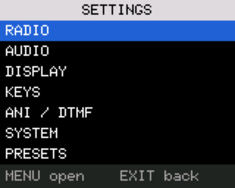

### Changing a value

1. Move to an item with `UP` and `DOWN`.
2. Press `MENU`. The row turns amber and `^` and `v` appear around the value.
3. `UP` and `DOWN` change the value. Pressing `0` sets it to its lowest choice (off, none, or the first in the list).
4. Press `MENU` to **keep** the change, or `EXIT` to **undo** it and put the old value back.

The strip at the bottom says which keys do what at that moment: `MENU change  EXIT back` when you are only looking, and
`UP/DN MENU save EXIT undo` while a value is being changed. For numbers you type it reads `0-9 type MENU ok EXIT del` (latitude and
longitude: `0-9  * N/S E/W  MENU ok`), and for VERSION and RF CHIP ID `UP/DN page    EXIT back`.

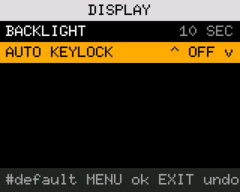

Notes:

* The new value takes effect as soon as you change it, before you press `MENU`; `EXIT` restores the old value.
* Items that are numbers you type (RPT OFFSET, BATTERY CAL, LATITUDE, LONGITUDE): press `MENU`, type the digits, press `MENU`
  to accept. `EXIT` deletes the last digit, and leaves the item when nothing is typed. In LATITUDE and LONGITUDE, `*`
  switches between N and S, or E and W. Type latitude as four decimals after two integer digits (`407100` is 40.7100 N) and
  longitude as three integer digits and four decimals.
* Some RADIO items (FREQ STEP, BANDWIDTH, TX POWER, RX TONE, TX TONE, RPT SHIFT, RPT OFFSET) and ANI CALL change the frequency
  currently on the main screen, not the stored settings. The source calls them "RAM-only".
* RESET ALL: `MENU` shows `MENU = WIPE` (strip: `MENU wipe all  EXIT cancel`); a second `MENU` erases the saved VFO data, the settings record, the saved channel state and the FM list and
  restarts the radio. Channels are not erased. After a reset, TX INHIBIT is on again. Read from the source; not tried on a radio.

### What is in each group

Names and choices are from the source. What each one does on the air has not been checked on a radio.

| Group | Items |
|---|---|
| RADIO | SQUELCH (0 to 9); FREQ STEP (2.50k to 100.00k); TX TIMEOUT (OFF, or 15 to 180 SEC in steps of 15); DUAL WATCH; BATTERY SAVE (OFF, 1 to 4); BUSY LOCKOUT; **TX INHIBIT**; BANDWIDTH (WIDE, NARROW); TX POWER (HIGH, LOW, MID); RX TONE; TX TONE; RPT SHIFT (OFF, +, -); RPT OFFSET; SCRAMBLER (OFF, 1 to 3); SCAN RESUME (TIMED, CARRIER, STOP); RIT (steps of 10 Hz, plus or minus 127); CH DISPLAY (FREQUENCY, NAME, NAME+FREQ) |
| AUDIO | KEY BEEP; VOX; VOX LEVEL (1 to 9); VOX DELAY (0.5 to 2.0 S); TONE BURST (1000, 1450, 1750, 2100 Hz); SQ TAIL ELIM; RPT TAIL DLY (OFF, 100 to 1000 MS); ROGER BEEP (OFF, ROGER, MDC1200) |
| DISPLAY | BACKLIGHT (ALWAYS ON, 5, 10, 15, 20 SEC); AUTO KEYLOCK (OFF, 5, 10, 15 SEC) |
| KEYS | SIDE1 SHORT, SIDE1 LONG, SIDE2 SHORT, SIDE2 LONG, BAND LONG, VFO/MR LONG: see [below](#assigning-the-side-keys-band-and-vfomr-long-press) |
| ANI / DTMF | ANI ON PTT; ANI CALL |
| SYSTEM | **TX BANDS** (the transmit-range lock); LATITUDE; LONGITUDE (used by HAM TOOLS' grid locator); BATTERY CAL; BOOT SCREEN (OFF, LOGO); BOOT SOUND; VERSION (`MENU`, then `UP`/`DOWN` flips between `UV-5RM OPEN FW` and `SEE BOOT SCREEN`); RF CHIP ID; RESET ALL |

Defaults of a new settings record, from the source: TX INHIBIT on, TX BANDS `FCC HAM`, SQUELCH 3, TX TIMEOUT 120 s
(8 steps), CH DISPLAY NAME+FREQ, backlight 10 SEC, key beep on, boot screen LOGO.

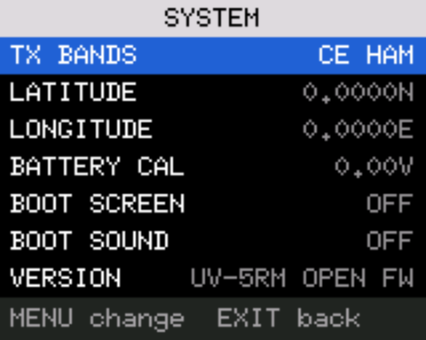

## CHAN MGR (the channel manager)

CHAN MGR (app 2) lists, edits, adds and deletes channels. It works on one channel group at a time.

### The list

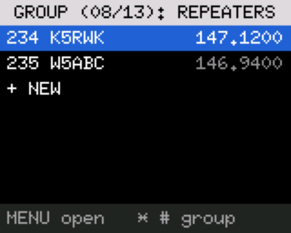

* The title names the group: `GROUP (08/13): REPEATERS` means group 8 of 13. If that is too long for the row, the position is
  dropped (`GROUP: CUSTOM RANGE`), and then the name is cut with `...`.
* When you open CHAN MGR it starts in the radio's current group. **`*` and `#` step to the previous and next group.**
* Each row is the channel number (the same number the main screen shows), the name and the receive frequency:
  `234 K5RWK  147.1200`.
* The last row is `+ NEW`. A group with nothing stored shows only that row.
* `UP` and `DOWN` move; `MENU` opens the highlighted channel, or starts a new one on `+ NEW`; `EXIT` leaves CHAN MGR.
  The strip reads `MENU open   * # group`.

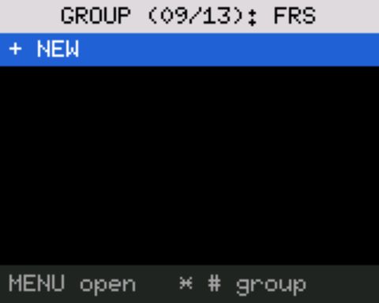

A new channel goes into the first empty slot inside the shown group. It starts with the frequency currently on the main screen,
LOW power and IN SCAN LIST on.
If the group has no empty slot left, `MENU` on `+ NEW` does nothing (no message is shown).

### Opening a channel and its fields

The title is the channel number (`CH002`), or `NEW` and the slot it will take (`NEW CH235`). The fields, top to bottom:

| Field | What it is |
|---|---|
| FREQUENCY | Receive frequency. |
| RPT SHIFT | OFF, `+` or `-`. |
| RPT OFFSET | The shift. |
| RX TONE, TX TONE | OFF, a CTCSS tone or a DCS code. |
| TX POWER | HIGH, LOW or MID. |
| BANDWIDTH | WIDE or NARROW. |
| IN SCAN LIST | Whether scanning visits this channel. |
| BUSY LOCKOUT | Blocks transmitting while the channel is busy. |
| ANI CALL | `#1` to `#20` (a DTMF contact) or NONE. |
| NAME | Up to 12 characters. |
| SAVE | Writes the channel. |
| DELETE | Only for channels that already exist. |

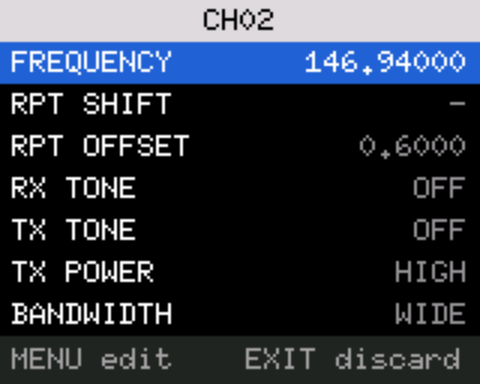

Keys, not editing: `UP`/`DOWN` move between fields (they wrap), `MENU` starts editing the field, `EXIT` goes back to the list. The
strip reads `MENU edit    EXIT discard` (on SAVE: `MENU save    EXIT discard`; on DELETE: `MENU delete  EXIT discard`).

**`EXIT` on the field list leaves without saving. Anything you changed is thrown away. Use SAVE.**

Keys while editing a field:

* Choice fields (shift, tones, power, bandwidth, scan list, busy lockout, ANI call): `UP`/`DOWN` change the value, `MENU` keeps
  it, `EXIT` undoes it, `0` sets the first choice (OFF or NONE). The strip reads `UP/DN  MENU ok  EXIT undo`.
* FREQUENCY and RPT OFFSET: type digits (`0-9 type MENU ok EXIT del`). For a frequency, type three digits of MHz and
  five of decimals, for example `14652000` for 146.520 00 MHz; it is accepted after the eighth digit, or press `MENU` earlier
  and the missing digits count as zeros. For the offset, type three digits of MHz and four of decimals (`0006000` is 0.6000).
  `EXIT` deletes the last digit, or cancels if nothing is typed.
* NAME: see the next section.

When the frequency or shift changes, the transmit frequency follows (receive frequency plus or minus the offset).

### Naming a channel

Select NAME and press `MENU`. A cursor appears in the name. Letters are typed the way old mobile phones did it: press a key
repeatedly to step through its letters; wait about a second, or press another key, to fix the letter.

| Key | Characters, in the order they come up |
|---|---|
| `0` | space |
| `1` | `,` `.` `?` `1` |
| `2` | `A` `B` `C` `a` `b` `c` `2` |
| `3` | `D` `E` `F` `d` `e` `f` `3` |
| `4` | `G` `H` `I` `g` `h` `i` `4` |
| `5` | `J` `K` `L` `j` `k` `l` `5` |
| `6` | `M` `N` `O` `m` `n` `o` `6` |
| `7` | `P` `Q` `R` `S` `p` `q` `r` `s` `7` |
| `8` | `T` `U` `V` `t` `u` `v` `8` |
| `9` | `W` `X` `Y` `Z` `w` `x` `y` `z` `9` |

After the last character a key wraps to its first. Example: press `5` twice for `K` (once is `J`, three times `L`); seven
presses give the digit `5`. The strip reads `0-9 UP/DN MENU ok EXIT del`.

* `UP` and `DOWN` move the cursor left and right.
* `EXIT` deletes the character before the cursor.
* `MENU` accepts the name. It is still only part of the unsaved channel until you use SAVE.
* A long press of `EXIT` leaves the name editor without accepting what you typed. (The strip does not say so.)
* A name holds at most 12 characters.

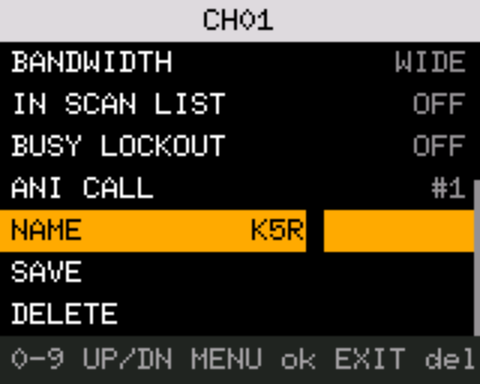

### SAVE and DELETE

* **SAVE:** select the SAVE row and press `MENU`. The channel is written and you return to the list with the channel
  selected. A box reading `SAVED CH001` (green) shows for about a second and a half, or until you press a key.

  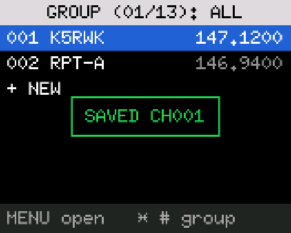

* **DELETE:** select DELETE and press `MENU`; the row reads `MENU = DELETE` (strip: `MENU delete it  EXIT keep`). `MENU` again erases the channel (no notice
  is shown); `EXIT` cancels.

Channels written by stock firmware or CHIRP have a name field padded with `FF` bytes. CHAN MGR treats that as an empty
name, so you can type one. (This was found on the radio and fixed; the fix has not yet run on the radio.)

## Assigning the side keys, BAND and VFO/MR long-press

SETTINGS > KEYS holds six items:

| Item | Press |
|---|---|
| SIDE1 SHORT, SIDE1 LONG | short or long press of `SIDE1` |
| SIDE2 SHORT, SIDE2 LONG | short or long press of `SIDE2` |
| BAND LONG | long press of `BAND` (a short press of `BAND` always opens CH GROUPS and cannot be changed) |
| VFO/MR LONG | long press of `VFO/MR` |

Each takes one of these choices:

| Choice | What it does |
|---|---|
| NONE | Nothing. |
| BANDWIDTH | Toggles WIDE and NARROW for the active side. |
| MONITOR | Toggles monitor (opens the squelch). |
| AM/FM | Toggles the modulation. |
| TX TONE | While the key is held, keys the transmitter and sounds the TONE BURST tone. |
| SCAN | Starts scanning. |
| TX POWER | Steps LOW, MID, HIGH. |
| LIGHT | Toggles the flashlight. |
| REVERSE | Swaps receive and transmit frequencies (for listening on a repeater's input). |
| APP 1 to APP 9 | Opens the app in that APPS list slot. If the slot is empty nothing happens. |

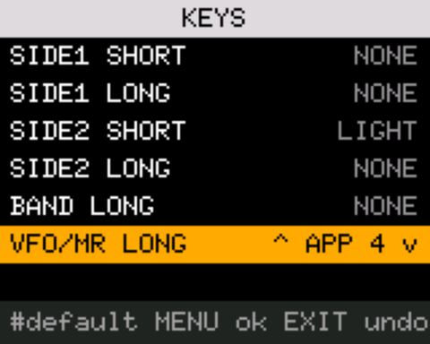

Things to know, all from the source (not yet run on a radio):

* **TX TONE works only as a SHORT choice** of `SIDE1` or `SIDE2`. Assigned to a LONG press it does nothing. It
  keys the transmitter, so TX INHIBIT and TX BANDS apply to it.
* The choice list skips two retired values (the old FM radio and search choices), so stepping never lands on a second NONE.
* The defaults stored in a new settings record are SIDE1 SHORT = 5 (the removed FM-radio choice, which shows as NONE and does
  nothing), SIDE2 SHORT = LIGHT; the long presses are NONE. To open the FM app from
  a side key, choose APP 9 (if FM is in slot 9).
* Pressing `0` while changing a value sets NONE.

## Transmit safety

Three things decide whether PTT transmits. All three must allow it.

1. **TX INHIBIT** (SETTINGS > RADIO). **On by default.** While on, PTT shows `TX INHIBIT IS ON` (`TX PROHIBITED` on the build
   tested on the radio) and the radio does not transmit.
   Leave it on until you have a dummy load on the antenna port.
2. **TX BANDS** (SETTINGS > SYSTEM; called TX BAND LOCK in earlier builds and in AUDIT.md). The set of frequencies the
   transmitter may use. **Default: FCC HAM.** Outside the chosen set, PTT shows `OUTSIDE TX BANDS`.
3. The channel itself: a memory channel with no transmit frequency is receive-only and shows `RX-ONLY CHANNEL`. AM never transmits (it shows `OUTSIDE TX BANDS`).

Also: TX TIMEOUT ends a transmission after the set time (default 120 seconds), and BUSY LOCKOUT stops PTT while the channel
is busy (`CHANNEL BUSY`).

### TX BANDS choices

| Choice | Transmit allowed on |
|---|---|
| CE HAM | 144 to 146 MHz and 430 to 440 MHz |
| **FCC HAM** (default) | 144 to 148, 222 to 225 and 420 to 450 MHz; FRS/GMRS 462.550 to 462.725 and 467.550 to 467.725 MHz; MURS 151.820 to 151.940 and 154.570 to 154.600 MHz |
| GB HAM | 144 to 148 MHz and 430 to 440 MHz |
| 400-430 | 137 to 174 MHz and 400 to 430 MHz |
| 400-438 | 137 to 174 MHz and 400 to 438 MHz |
| PMR446 | 446.00625 to 446.19375 MHz |
| GMRS/FRS | 462.550 to 462.725 and 467.550 to 467.725 MHz, and the five MURS channels (151.820, 151.880, 151.940, 154.570, 154.600 MHz) |
| CA HAM | 144 to 148 MHz and 430 to 450 MHz |
| NONE | Nowhere: transmit is off on every frequency (called NO TX in earlier builds) |
| ALL (called ALL BANDS in earlier builds) | 136 to 174 MHz **except the NOAA weather channels** (162.3875 to 162.5625 MHz are blocked), 220 to 260 MHz and 400 to 520 MHz. Nothing below 136 MHz. These are the limits the stock firmware reports for this radio |

The same rule applies to VFO and memory channels. The 400-430 and 400-438 choices are the upstream mod's (they start at 137
MHz, as in the source). There is no per-band power limit.

ALL was narrowed from "the synthesizer's whole range" on 2026-11-11 and has not run on a radio. Whether the transmitter is
clean across all of 136-174, 220-260 and 400-520 MHz has not been measured. Choosing it is your decision and your
responsibility; the radio does not know your licence.

Only one shipped app transmits: **TEXT**. It shows `TX BLOCKED: SEE SETTINGS` when TX INHIBIT or TX BANDS stops it. Every
other app only receives. The `TX TONE` key function also transmits.

## The apps

Open an app from the APPS list. Every app leaves with `EXIT`, unless the app says otherwise. Keys are from the source of each
app and have not been tried on a radio. Frames below come from the simulator's scenarios, in which every radio signal is
scripted.

### SPECTRUM

A panadapter: a trace of signal strength over a stretch of spectrum, with a waterfall under it. It opens centred on the
frequency on the main screen. It only receives.

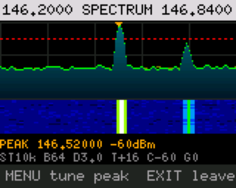

The top line shows the start and stop frequency of the window. At the bottom, line one shows a typed frequency (`F`), the
frequency being listened to (`RX`), the peak (`P`) or the pan step; line two shows `ST` (frequency step), `B` (bins), `D`
(dwell), `T+` (trigger margin, dB), `C` (top of the scale, dBm), `G` (gain: a number, or `A` for automatic) and `A` when
auto-listen is on.

| Key | Action |
|---|---|
| `UP` / `DOWN` | Move the window up or down by the pan step. |
| `1` / `7` | Larger / smaller scan step. |
| `2` / `8` | Larger / smaller pan step. |
| `3` / `9` | Raise / lower the top of the scale. |
| `*` / `#` | Raise / lower the trigger margin. |
| `4` | Cycle the number of bins (128, 64, 32, 16). |
| `5` | Type a centre frequency (six digits, MHz with three decimals), `MENU` to accept. |
| `0` / `6` | Longer / shorter dwell per bin. |
| `MENU` | Turn auto-listen on or off. With it on, the app stops sweeping and plays the audio of the strongest signal above the trigger. |
| `SIDE1` | Blacklist the current peak (ignore that bin). |
| `SIDE2` | Step the fixed gain through its choices, then back to automatic. |
| `EXIT` | Leave. Any other key stops a listen first. |

### BAND SWEEP

Repeated passes over a whole band, much wider than SPECTRUM, with a list of the strongest frequencies found. It only
receives. Its bands are VHF (136 to 174 MHz), UHF (400 to 520), AIR (118 to 137), 220 (200 to 260), 350 (300 to 390) and a
custom range.

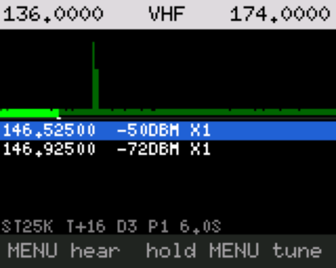

The status line shows the band, step (`ST25K` or `ST12.5K`), `T+` (detection margin), `D` (dwell) and `P` (pass count and
time). The bottom line reminds you of the keys.

| Key | Action |
|---|---|
| `UP` / `DOWN` | Select a hit in the list. |
| `MENU` | Listen to the selected hit (`RX` line). `MENU` or `EXIT` goes back to the sweep. |
| Hold `MENU` | Put the selected hit on the main screen's VFO and leave the app. |
| `A/B` | Next band (VHF, UHF, AIR, 220, 350). |
| `1` | Switch the step between 25 and 12.5 kHz. |
| `5` | Type a custom range: start, `MENU`, stop, `MENU` (six digits each, MHz with three decimals). |
| `0` / `6` | Longer / shorter dwell. |
| `*` / `#` | Raise / lower the detection margin. |
| `SIDE1` | Remove the selected hit from the list. |
| `EXIT` | Leave. |

A known quirk (AUDIT.md row 16): the list shows the sweep's grid frequency, which can be a few kHz off the signal's true
frequency.

### FOX HUNT

A large signal meter that says whether a transmitter is getting stronger or weaker, and a rough distance once you have
calibrated it. It only receives. It starts on the frequency on the main screen with the audio on and the backlight held on; `1` turns the audio off and on (the display then shows `MUTED`).

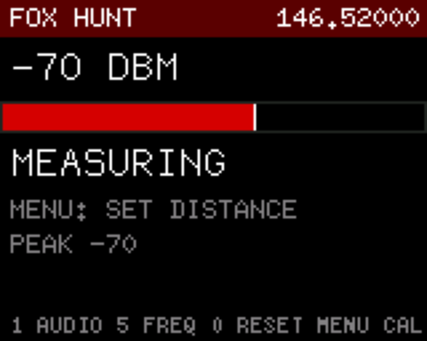

| Key | Action |
|---|---|
| `1` | Audio on or off. |
| `5` | Type a frequency (six digits, MHz with three decimals), `MENU` to accept. |
| `MENU` | Calibrate the distance: when you are at a known distance from the signal, press `MENU`, type the distance in tenths of a mile (`1` `0` is 1.0 mile), `MENU`. Needs a signal first. |
| `0` | Reset the calibration and the peak. |
| `EXIT` | Leave (from the entry screens: back to the meter). |

The bar and a word (`CLOSER +`, `FARTHER -`, `SAME`, `MEASURING`, `TOO STRONG`) say how the signal is changing. After
calibration the app shows `ABOUT x MI`, a rough range based on 20 dB per tenfold distance in the open and about 40 dB in
clutter. Treat it as a guide only.

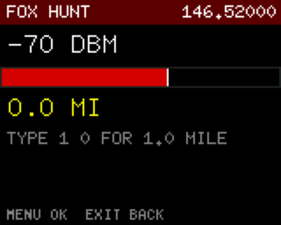

### RPT FINDER (repeater finder)

While someone is talking on a repeater's output, it looks at the usual input frequencies for the same traffic and tries to read
the tone. It only receives. Tune the main screen to the repeater's output frequency first.

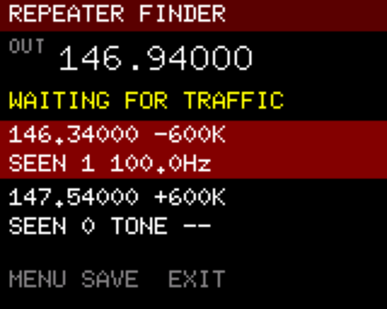

It checks inputs at -600 and +600 kHz (144 to 148 MHz), -1.6 MHz (222 to 225 MHz), +/-5 MHz (420 to 450 MHz) and +5 MHz in
the GMRS repeater output range. The status line reads `NO STANDARD OFFSET`, `CHECKING INPUTS`, `WAITING FOR TRAFFIC` or
`READING TONE`. Each candidate shows how often it was seen and its tone (`NO TONE`, `TONE --`, or for example `100.0Hz`).

| Key | Action |
|---|---|
| `UP` / `DOWN` | Switch between the two candidates, when there are two. |
| `MENU` | Once a candidate has been seen, ask for a channel number to save it to. |
| `EXIT` | Leave. |

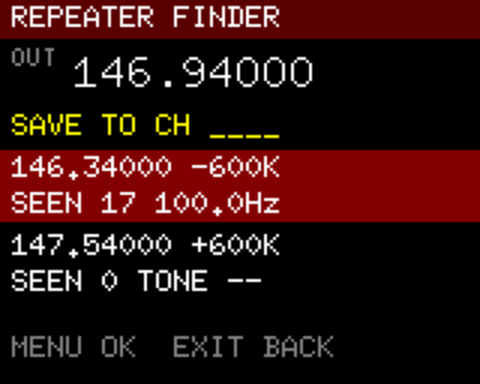

To save, type a channel number from 1 to 1000 (up to four digits) and press `MENU`. The channel gets the output as receive
frequency, the input as transmit frequency, the tone on transmit, LOW power, narrow if the radio was narrow, scan on, and the name
`RPT 146.940`. **It never overwrites a channel:** if the number is in use it shows `CH n IN USE`; a bad number shows
`BAD CHANNEL`. `EXIT` goes back. With simple on/off traffic in the simulator the app was still checking after two minutes
(AUDIT.md row 16); how fast it concludes on real repeaters is unknown.

### SEARCH/QT SCAN

One app, two screens. It opens on QT SCAN. Press `1` to switch to the other screen and back. It only receives.

**QT SCAN** listens on the main-screen frequency. When a signal opens the squelch it reads the CTCSS tone or DCS code it
carries.

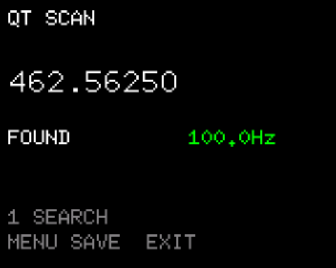

| Key | Action |
|---|---|
| `UP` / `DOWN` | Start detecting again (when a tone was found). |
| `MENU` | When found: store the tone as the receive tone, and also as the transmit tone if it is CTCSS, on the main screen's current setup, and leave. In VFO mode it is saved with the VFO; in memory mode it is not written to the channel. |
| `1` | Switch to SEARCH. |
| `EXIT` | Leave. |

**SEARCH** finds the frequency of a nearby transmitter by counting its carrier, then reads the tone. `HUNTING...`, `LISTEN` and
`FOUND` show its progress. It is for finding the frequency of a signal you cannot identify.

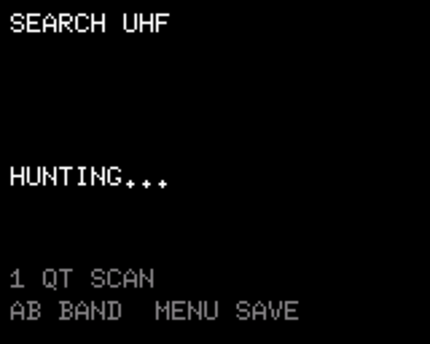

| Key | Action |
|---|---|
| `A/B` | Next band: UHF, VHF, 220M, 350M. |
| `UP` / `DOWN` | Start again (when found). |
| `MENU` | When found: set the main screen to that frequency (VFO mode) with the tone found, and leave. |
| `1` | Switch to QT SCAN. |
| `EXIT` (short or long) | Leave. |

### TEXT

Short text messages between two radios using the radio chip's FSK modem. **It transmits.** Both radios must run TEXT on the same
frequency. The frequency is the one on the main screen when you open the app; the title shows it and `LOW` or `HIGH` power.

> **A radio with TEXT open answers messages by transmitting on its own.** A message is repeated up to eight times until the
> other radio confirms it. Use it only on a frequency where you are licensed and permitted to send digital data, on simplex.
> TEXT has never been tested on the air; the simulator transmits into a model.

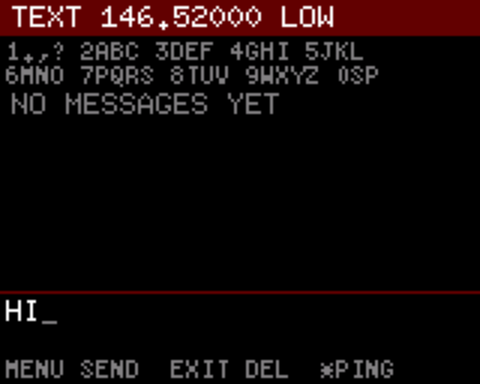

| Key | Action |
|---|---|
| `0` to `9` | Type with the multi-tap keys, upper case only. `0` is space (again for the digit 0); `1` gives `. , ? ! - / 1`; `2` gives `A B C 2`; `3` `D E F 3`; `4` `G H I 4`; `5` `J K L 5`; `6` `M N O 6`; `7` `P Q R S 7`; `8` `T U V 8`; `9` `W X Y Z 9`. The letter is fixed after about a second. A message holds up to 50 characters. |
| `MENU` | Send the typed message. |
| `*` | Send a numbered test message (`PING 1`, `PING 2`, ...). |
| `A/B` | Switch between LOW and HIGH power. |
| `UP` / `DOWN` | Scroll the message list. |
| `EXIT` | While sending: stop retrying (`STOPPED: NOT CONFIRMED`). Otherwise delete the last typed character; with nothing typed, leave. |
| Hold `EXIT` | Leave. |
| Hold `#` twice | Erase all stored messages (the first hold asks `HOLD # AGAIN TO ERASE ALL`). |

Messages are kept in the radio's flash memory until overwritten or erased. Notices include `NEW MESSAGE`, `DELIVERED`,
`NOT CONFIRMED`, and `TX BLOCKED: SEE SETTINGS` when TX INHIBIT or TX BANDS stops it.

### FM

The FM broadcast receiver, 87.5 to 108.0 MHz, with a list of 30 saved stations. Broadcast FM uses a separate tuner chip, so
it is an app and not a VFO band; typing a frequency in that range on the main screen in VFO mode (`0981` and so on) opens
this app already tuned to it, and `EXIT` returns to the main screen. The simulator does not model that tuner, so the picture shows no stations. Nothing about this app has been checked on this
radio.

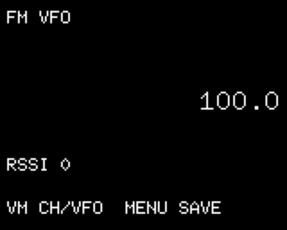

| Key | Action |
|---|---|
| `UP` / `DOWN` | VFO mode: 0.1 MHz up or down. Channel mode: next saved station. |
| Hold `UP` / `DOWN` | Seek to the next station. |
| `0` to `9` | VFO mode: type four digits (`1015` is 101.5 MHz). Channel mode: type a two-digit slot number. |
| `VFO/MR` | Switch between VFO and saved channels (needs at least one saved channel). |
| `MENU` | Open the save list: `UP`/`DOWN` choose a slot, `MENU` saves the current frequency there, `EXIT` cancels. |
| `EXIT` | Clear a half-typed number, otherwise leave. |

### HAM TOOLS

Four small tools: station-ID timer, stopwatch, wavelength calculator and grid locator. It only receives. It is built with
the release but is not in a slot by default (see [APPS list](#the-apps-list-menu)). **Leaving the app loses the timers.**
`A/B` moves to the next tool.

| Tool | Keys |
|---|---|
| ID TIMER | `MENU`: "I just identified", restart the countdown. `*`: arm or disarm. `UP`/`DOWN`: set the interval, 1 to 30 minutes in 1-minute steps (only while disarmed). Default 10 minutes. When overdue it flashes `ID NOW`, holds the backlight on and beeps every 30 seconds (the beep follows KEY BEEP). |
| STOPWATCH | `MENU`: start/stop. `*`: lap (four laps shown). `0`: reset. |
| WAVELENGTH | Type the frequency in kHz (six digits). `*` clears. Shows full, half and quarter wave and a quarter wave at velocity factor 0.95. |
| GRID LOCATOR | Shows the six-character Maidenhead locator for the position in SETTINGS > SYSTEM > LATITUDE and LONGITUDE; `NO POSITION SET` until you enter it. |

While the ID timer is armed or the stopwatch is running, a short `EXIT` only shows `HOLD EXIT: TIMER RUNS`; hold `EXIT` to
leave.

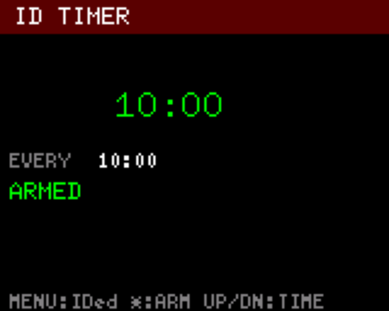

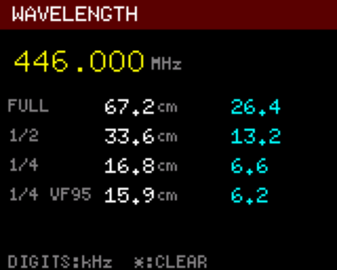

### FSK PROBE

A bring-up tool: does the radio chip's FSK modem hear anything, and what do its registers say? It only receives and is for
people debugging the radio, not for ordinary use. Its source says the crystal, the sync words and whether the modem hears a
real signal at all are all unverified on this radio. It starts on 404.800 MHz at 4800 baud with the RS41 radiosonde's
frame header as the sync word.

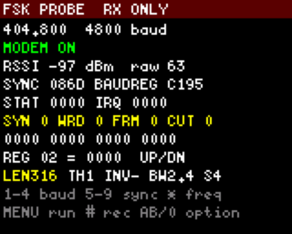

| Key | Action |
|---|---|
| `MENU` | Modem on or off. |
| `*` | Next frequency (404.800, 144.390, 146.520, 446.000, 434.714 MHz). |
| `1` to `4` | Baud rate: 450, 1200, 2400, 4800. |
| `5` to `9` | Sync word: 7E7E, 2DD4, AAAA, RS41 header (`8`), RS41 header in the other bit order (`9`). |
| `#` | Start a capture, or stop the one running. |
| `UP` / `DOWN` | Pick the register shown at the bottom. |
| `EXIT` | Turns the modem off (ending any capture) and leaves. |

**Capture.** `#` records every word the modem delivers, with the time, sync flag and signal strength, so a decoder can be
designed from real data. The screen shows `ERASING` for a moment, then `REC` with a count, and `SAVED` with the total
after `#`, `MENU` or `EXIT` ends it. The frequency, baud rate and sync word cannot be changed while it runs. It holds
16,352 records (about 55 seconds of continuous 4800 baud data), then shows `REC FULL` and records no more; it cannot
write outside its own 128 KB of the radio's flash (0x1B0000 to 0x1D0000). Each new capture replaces the last. To copy
one to the computer, leave the app (the radio must be on its main screen) and run:

    python3 firmware/source-changes/probe_capture.py PORT my-capture.bin

It prints a summary (records, sync count, time between words, signal strength) and writes `my-capture.csv` beside the
file. The tool only reads, and only that range.

## Loading channel lists from a computer

The `channels/` folder holds one CHIRP-format CSV file per channel group: `weather.csv` (7 NOAA weather channels), `frs.csv`
(FRS/GMRS 1 to 22), `gmrs.csv` (GMRS repeaters), `murs.csv` (5 MURS channels) and `repeaters.csv` (the owner's local
repeaters, Dallas area; `gmrs.csv` currently also lists Dallas-area repeaters, so replace both with your own). The file name says which group's numbers it fills. See
[channels/README.md](../channels/README.md) for the rules; the main points:

* A file fills only its own group's channel numbers, in file order. Weather goes to 1 to 7, repeaters to 234 to 304, FRS to 305
  to 326, GMRS to 327 to 344, MURS to 345 to 349.
* Names are at most 12 ASCII characters and are never cut: a longer name stops the build. The `Detail` column is checked but
  not stored on the radio yet.
* If a group overflows, two files claim a slot, or a row cannot be read, the build fails and writes nothing.

The commands (run on a computer, in the repository folder):

```
python3 firmware/source-changes/channel_plan.py build channels -o build-out/channels.img --base my-backup/NAME.img
python3 firmware/source-changes/restore_backup.py PORT build-out/channels.img --before build-out/undo.img            # dry run
python3 firmware/source-changes/restore_backup.py PORT build-out/channels.img --before build-out/undo.img --write    # writes
```

* **Use `--base` with a backup** from `radio_read.py` (see below). Without it, every slot the CSV files do not fill is written
  empty, which erases whatever the radio has there. The `--before` file is an undo image.
* `channel_plan.py show IMAGE` prints any image or backup as a table.
* The first command does not touch a radio. The other two use the serial port; run the dry run first.
* **Not yet run on a radio.** This whole path has been tested only against a fake radio.
* This radio is not certified for FRS, GMRS or MURS. Use those lists to listen unless your licence and the rules allow
  otherwise. Which frequencies it will transmit on is decided by TX BANDS and TX INHIBIT.

## Backing up and flashing

Do not repeat the steps from memory. Follow [FIRST-FLASH-RUNBOOK.md](FIRST-FLASH-RUNBOOK.md): it starts with read-only steps,
says which cable to use, what can and cannot be restored, and where to stop. The short version:

* **Take a backup before anything else** with `radio_read.py`, and a second one with CHIRP.
* **There is no stock firmware image for this radio.** Flashing is effectively one way (see [HARDWARE.md](../HARDWARE.md)).
* Flash only an image built by CI, never the `.BF` committed in the repository ([AUDIT.md](../AUDIT.md), row 6).
* Keep TX INHIBIT on until a dummy load is on the antenna port.
* Never commit radio backups to git.

Other documents: [HARDWARE.md](../HARDWARE.md) (the radio's hardware), [AUDIT.md](../AUDIT.md) (what has and has not been
verified), [CHANNEL-GROUPS.md](CHANNEL-GROUPS.md) (ideas for groups; not built).

## Personal boot screen and start-up tune

Not yet tried on a radio. The boot screen is a picture stored on the radio (the boot logo), so it can carry your callsign,
name, the radio's board and the firmware build it was made from.

1. Copy `.env.sample` to `.env` and fill in `OWNER_CALLSIGN`, `OWNER_NAME`, `RADIO_BOARD` and the rest. `.env` is ignored by
   git, so your details are not committed.
2. `scripts/dev.sh personalize` draws `build-out/personal/boot-logo.rgb565` and a preview, `boot-logo.png`. Look at the preview.
   The bottom strip shows the commit and date; a `+` after the commit means there were uncommitted changes. Run it again after
   each firmware build you flash, so the screen names the build that is on the radio.
3. `python3 firmware/source-changes/boot_logo_raw.py PORT build-out/personal/boot-logo.rgb565 my-backup/logo-before.rgb565`
   saves the logo that is on the radio, writes the new one and reads it back. Run it again with the backup file as the logo to undo.
4. Start-up tune: `python3 firmware/source-changes/set_boot_tune.py PORT my-backup/settings-before.bin doom` (or `mario`).
   It changes only the tune inside the settings record and keeps a backup of the record.

BOOT SCREEN must be LOGO and BOOT SOUND must be ON (SETTINGS > SYSTEM) for the picture and the tune to appear.
